# 인지 파트 진행 보고서

2026-11-25 · 브랜치 `dev/two-track`

## 0. 한눈에 보기

- **우리 팀 범위:** 인지만 맡는다. **선을 잘 따고, 안 보이는 곳은 복원한다.** 판단·제어는 기존 구현(공식 트랙 약 64초)으로 고정하고, 장애물은 없다고 가정한다.
- **확인된 개선 1 – 경사로 IMU 보정 (기본값으로 채택):** 기준선이 늘 실패하던 맵의 실행당 성공률이 5.4%에서 16.7%로 올랐다(p = 0.003). 공식 트랙은 8/8 완주했다.
- **확인된 개선 2 – 학습 기반 선 복원 R3 (채택 후보):** 같은 조건에서 비교했다. 늘 실패하던 맵이 11.6%에서 25.9%가 됐고(p = 0.005), 늘 성공하던 맵에서는 회귀가 거의 없었다(3개 → 4개). 공식 트랙은 한 번 더 확인해야 한다.
- **실물 대상:** Jetson Orin Nano 8GB. 모델은 ONNX로 만들고, Jetson에서는 TensorRT로, GPU가 없는 채점 PC에서는 CPU로 돌린다.

---

## 1. 무엇을 기준으로 평가하나

### 1.1 목적별 시험 맵 334개 (`experiments/worlds/suites/cases`)

각 맵에는 상황이 하나만 들어 있고, 모두 좌우 반전 쌍이 있다. 교차 위치와 교차 각도는 생성한 뒤 자동으로 계산해 기록한다.

| 분류 | 포함된 상황 |
|---|---|
| 기하 | 90° 코너(반경 0–40 cm), 30–150° 꺾임, S자, U턴, 지그재그, 물결, 나선 |
| 교차·겹침 | 가로선 교차 30–90°, 연속 교차, 원형 교차로, 자기 교차, 3–20 cm 간격 평행선, Y 갈림·합류, T자 가지, 겹침, 다른 선과 접촉 |
| 선 품질 | 3–20 cm 끊김(직선·곡선), 점선 |
| 언덕 | 경사로(3–7 cm), 경사로 직후 회전, 회전 직후 경사로, 경사로 위 교차·끊김, 연속 경사로 |

| 자기 교차 | 경사로 직후 회전 |
|---|---|
| 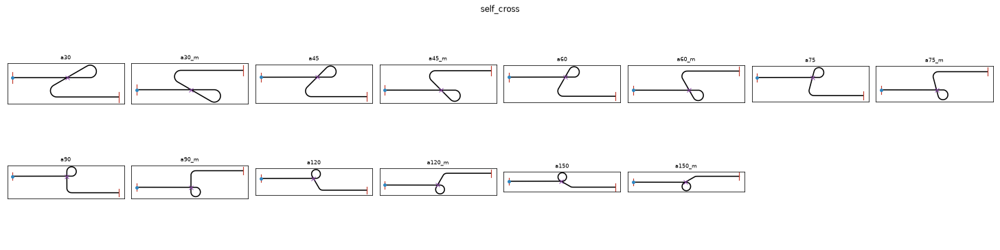 | 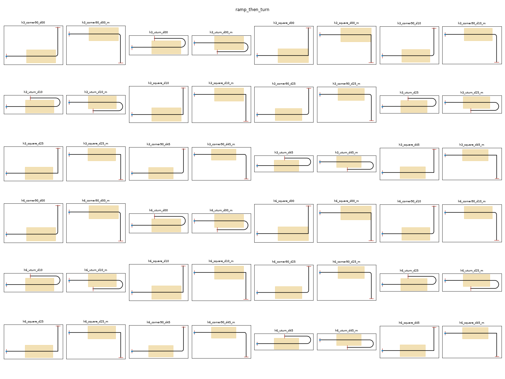 |

### 1.2 판정 방법

- 기준선을 같은 맵에서 3번씩 돌려 맵을 세 부류로 나눴다. **항상 성공** 251개, **들쭉날쭉** 27개, **항상 실패** 56개다.
- 새로운 방법은 두 가지를 동시에 만족해야 채택한다. 항상 실패 맵을 성공으로 바꾸고, 항상 성공 맵을 깨지 않아야 한다. 공식 트랙 완주도 유지해야 한다.
- 비교는 반드시 같은 시간대에 같이 돌린 기준선과 한다. 단측 Fisher 검정으로 개선이 우연인지 판정한다.
- 실행마다 결과가 그룹당 ±3개 정도 흔들리고, CPU 부하가 높을 때 특히 크다. 그래서 한 번 돌린 결과만으로는 판단하지 않는다.

### 1.3 섀도 기록 (`experiments/oracle/shadow_route.py`, 개발 전용)

주행 중에 노드가 따라가려는 경로를 실제 선과 비교해서, 로봇 기준 오차를 프레임마다 남긴다. 정답 좌표는 개발 도구에서만 쓰고 제출물에는 들어가지 않는다.

---

## 2. 무엇이 문제였나

### 2.1 원인 나누기: 오라클 실험

경로를 정답으로 바꿔 주면 항상 실패하던 맵 56개 중 **46개가 완주한다.** 시야를 카메라만큼 제한해도 42개가 완주한다. 그러니 실패의 대부분은 제어가 아니라 **인지(경로 품질) 문제**다.

경로의 일부 구간만 정답으로 바꾸는 부분 오라클로 더 좁혀 봤다. 경사로 직후 회전 6맵에서 **"경사로 끝 → 회전 진입" 약 0.7 m 구간**만 경로가 맞으면 6/6이 완주한다.

### 2.2 경사로 근처에서 선이 엉뚱한 곳에 그려진다

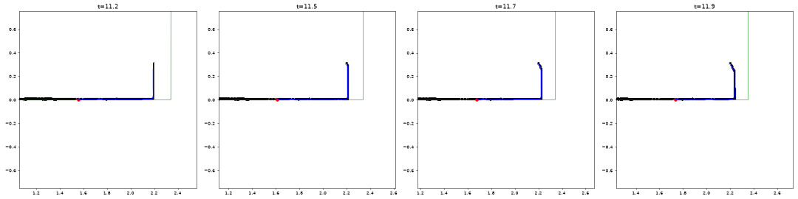

직각 코너가 실제 위치(초록)보다 13–15 cm 앞에 기록됐다. 원인을 프레임별로 추적하면 두 가지다.

- **꼭대기에서 멀리 볼 때:** 꼭대기 너머의 바닥은 로봇이 선 면보다 낮다. 평면이라고 가정하고 투영하면 선이 실제보다 가깝게 찍힌다(p90 오차 15 cm).
- **내리막에서 차체가 고꾸라질 때:** 차체가 −10°에서 −21°까지 숙여진다. 이때 경사면과 카메라가 평행하다는 가정이 13° 넘게 어긋난다(오차 13–19 cm).
- **추가 요인:** 오르막에서 바퀴가 헛돌아 주행거리를 6–7% 많게 센다. 이 오차가 코너를 돈 뒤에는 옆 방향 오차가 된다.

### 2.3 카메라는 보는데 버리고 있었다

| 실제 카메라 영상 | 노드가 쓰는 BEV (0.85 m에서 잘림) |
|---|---|
| 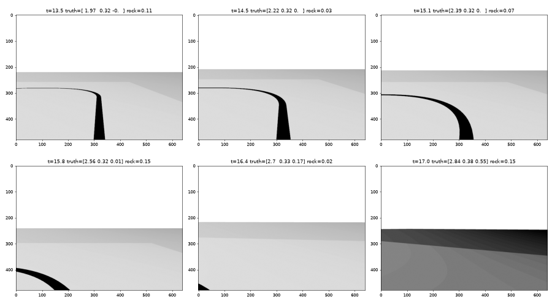 | 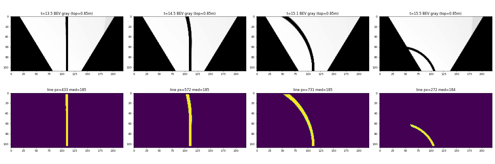 |

- 카메라는 1 m 너머의 U턴까지 보고 있다.
- BEV는 0.85 m에서 잘리고, 흔들릴 때는 0.5 m까지 줄어든다. 그래서 코너의 일부가 지도에 들어가지 못한다.

### 2.4 예각에서는 시야 밖으로 꺾인다

반경 0으로 120° 넘게 꺾이는 6맵은 기준선에서 6개 모두 실패한다. 꺾여 나가는 선은 지도에 기록되지만, 경로를 이어 붙이는 `trace`가 ±100°까지만 찾기 때문에 이어지지 않는다.

---

## 3. 시도한 것과 결과

| 시도 | 결과 | 판정 |
|---|---|---|
| **경사로 IMU 보정** (`imu_slip` 피치 변화율 0.3 rad/s 이상일 때만 + `imu_floor` + `deck_xfar 0.45`) | 항상 실패 맵 5.4% → 16.7% (p = 0.003), 공식 트랙 8/8, hills60 0/24 → 2/24 | **채택 (기본값)** |
| **학습 기반 선 복원 R3** (경로가 끊길 때만 사용) | 11.6% → 25.9% (p = 0.005), 항상 성공 맵 회귀 3 → 4 | **채택 후보** |
| 선 복원 R4 (더 큰 모델) | 24.1% (p = 0.011), 회귀 6 | R3와 차이 없음 |
| 매 프레임 복원 경로만 따라가기 (`restore_replace`) | 공식 트랙 0/4 | 기각 |
| 깊이 인지 (선 마스크 + 학습한 깊이로 투영) | 항상 실패 맵 9/56 (기준 3/56), 고부하 상태 측정 | 재판정 필요 |
| 선 폭으로 지형 높이 추정 (`terrain.py`) | 오프라인 오차는 절반으로 줄었으나 주행 개선 없음 | 기각 |
| 곡률 외삽, 흔들림 기준 완화, 원거리 덧쓰기, 감속, 시야 축소 | 우연 수준이거나 공식 트랙을 깸 | 기각 |
| 엔코더+IMU 미끄러짐 보정을 항상 켬 | 위치 오차는 16–19 cm → 2–3.5 cm로 줄었으나 공식 트랙 0/4 | 피치 변화율이 클 때만 켜는 방식으로 수정 |
| 예각 탐색을 ±150°까지 확대 (`trace_wide`) | 끊긴 선 맵 34개를 깨뜨림 | 기각 |

기각한 기능도 모두 파라미터로 남겨 두었고 기본값은 꺼져 있다. 자세한 기록은 `docs/OPEN_SOURCE_SURVEY.md` 5장에 있다.

---

## 4. 학습 모델

### 4.1 선 분할 (+깊이)

카메라 영상을 받아 픽셀마다 "선인지"와 "몇 m 앞인지"를 낸다. Gazebo 영상과 Isaac Sim 합성 영상을 섞어 학습했다.

| 공식 트랙 BEV: 정답 / OpenCV / 학습 모델 | 공식 트랙 한 바퀴 선 지도 |
|---|---|
| 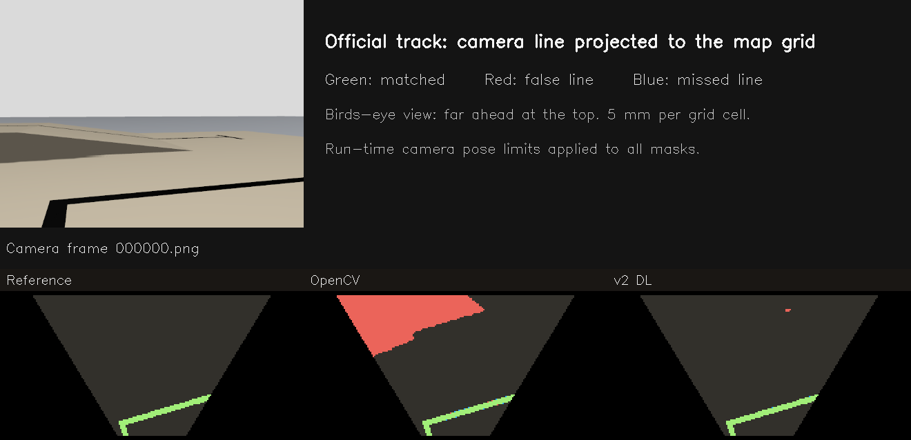 | 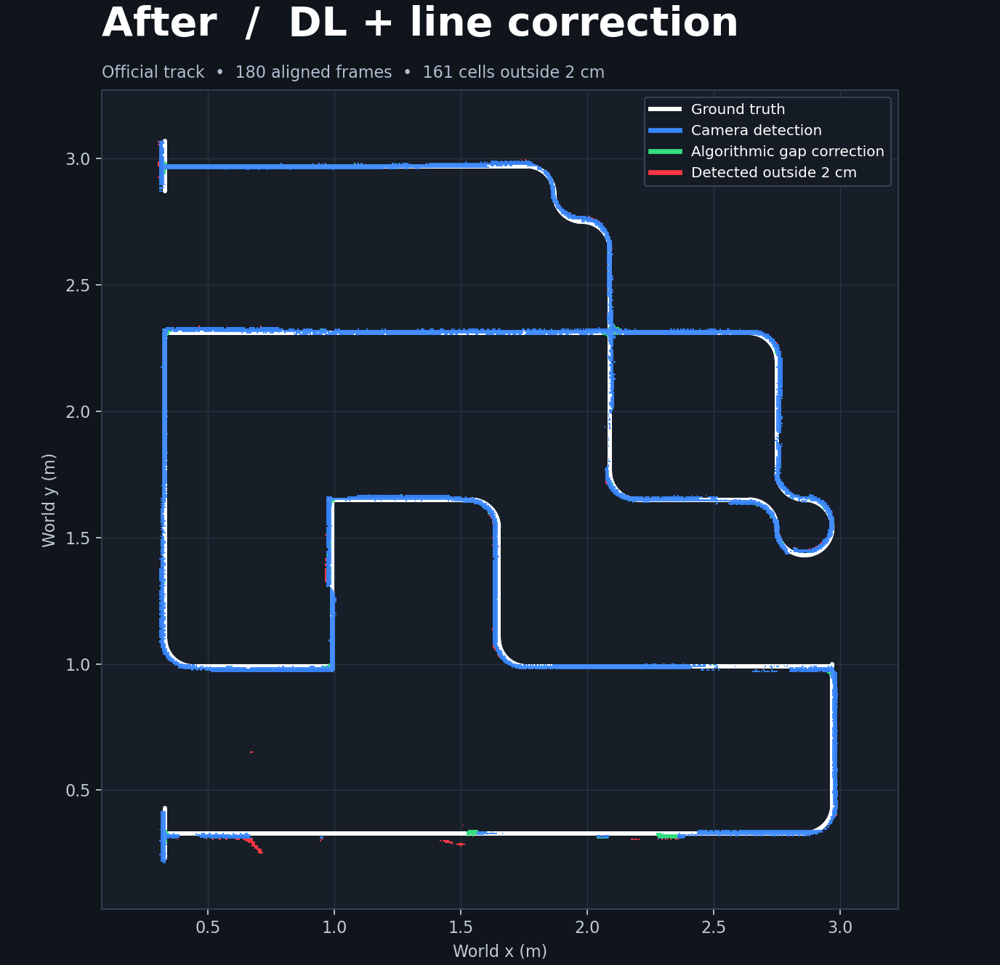 |

- OpenCV 임계값은 어두운 영역까지 선으로 잡는다(빨강). 학습 모델은 정답과 거의 같다.
- 정답에서 2 cm 넘게 벗어난 칸이 1,646개에서 161개로 줄었다.

| 모델 | 선 IoU | 선 깊이 오차 (먼 거리) | CPU 추론 |
|---|---|---|---|
| 선만 (기본형) | 0.894 | – | 약 9 ms |
| 분할+깊이 (기본형) | 0.890 | 1.63 cm (5.1 cm) | 9–17 ms |
| 분할+깊이 (소형, Jetson용) | 0.884 | 1.74 cm (5.0 cm) | 5–13 ms |
| 분할+깊이 480×360 입력 (학습 중) | – | 2 에폭 만에 먼 거리 4.5 cm | 약 2.25배 |

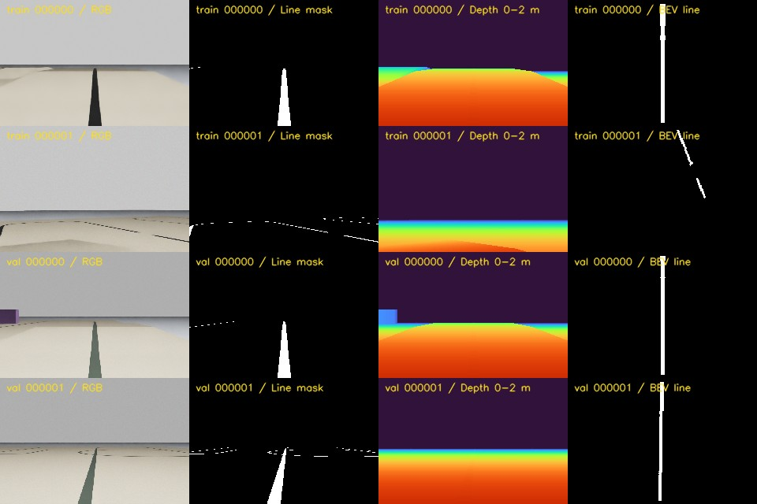

*Isaac Sim 합성 데이터. 왼쪽부터 RGB, 선 마스크, 깊이, BEV. 조명, 선 색, 노이즈를 무작위로 바꿨다.*

### 4.2 선 복원 (안 보이는 곳 잇기)

로봇이 지금까지 본 선과 본 영역(128×128, 1.25 cm 칸)을 입력으로 받는다. 출력은 앞으로 갈 경로다.

학습 데이터는 렌더링 없이 정답 트랙에서 바로 만든다. 카메라 시야, 근거리 사각지대, 끊김, 위치 오차, 검출 잡음을 흉내 내서 "로봇이 실제로 본 지도"를 생성한다.

| 시험 맵 기반 데이터 | 무작위 합성 트랙 (예각·U턴·교차·평행선 포함) |
|---|---|
| 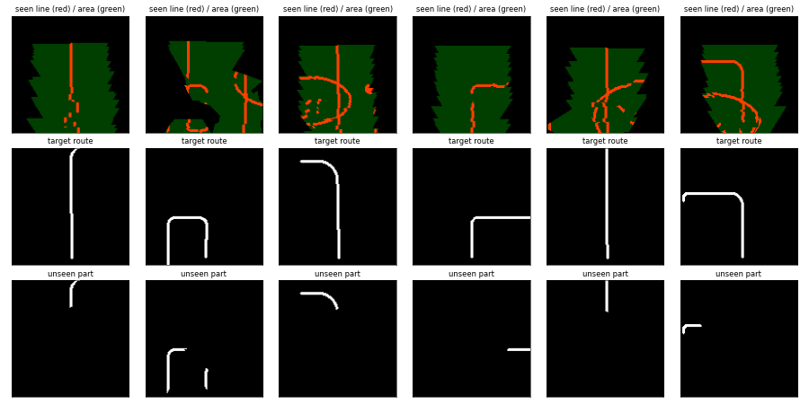 | 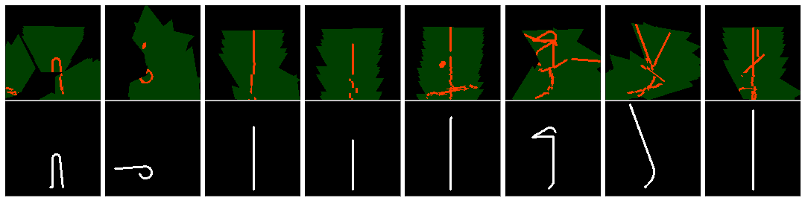 |

학습에 쓰지 않은 hills60과 케이스 맵 7,880장으로 평가했다.

| 모델 | 경로 IoU | 안 보인 구간 복원율 | 엉뚱하게 그린 비율 |
|---|---|---|---|
| 복원 없음 | 0.446 | 8.9% | 29.9% |
| R1 (4만 장) | 0.725 | 82.3% | 11.0% |
| **R3 (10만 장, 합성 트랙 포함)** | **0.750** | **89.1%** | **10.1%** |
| R4 (폭 32) | 0.737 | 90.0% | 11.8% |

**예각에서 합성 데이터가 효과를 냈다.** R1은 꺾여 나가는 선을 무시했지만, R3는 그 선을 경로로 잡는다.

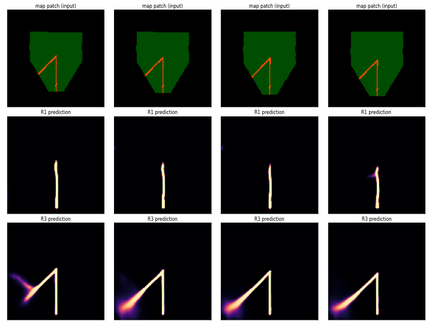

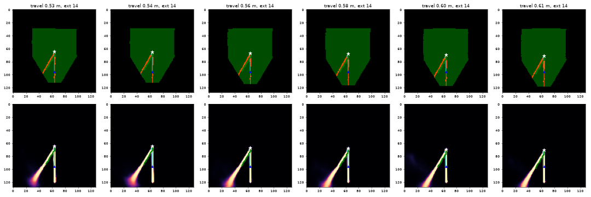

*실제 주행에서 R3가 150° 예각을 이어 붙이는 장면. 초록이 복원된 경로다.*

R3가 가장 못한 사례들:

| 안 보인 구간을 놓친 10개 | 엉뚱하게 그린 10개 |
|---|---|
| 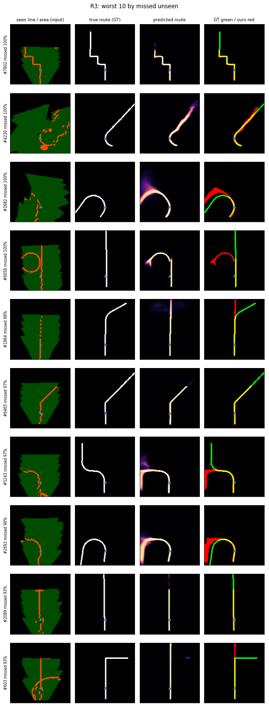 | 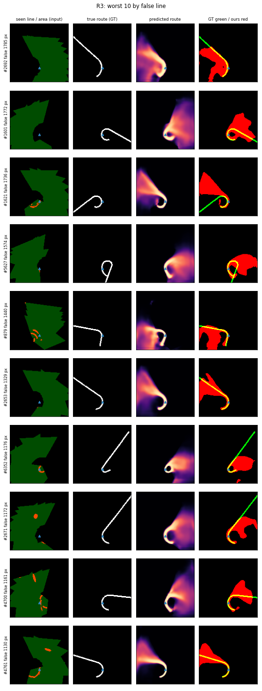 |

- **시야 밖에서 꺾이는 경우:** 본 것만으로는 원래 알 수 없다. 그래서 주행에서는 0.4 m만 잇는다.
- **원형 교차로나 U턴 근처:** 다른 가지를 고르는 경우가 있다.
- **본 것이 거의 없을 때:** 넓은 얼룩을 그린다. 그래서 확률 0.5 이상인 연결된 선만 따라가게 했다.

---

## 5. Jetson Orin Nano 대응

- **추론 엔진:** onnxruntime를 쓰고, 공급자는 TensorRT(FP16) → CUDA → CPU 순으로 고른다. onnxruntime가 없으면 OpenCV DNN으로 넘어간다. 선 복원과 깊이 인지에 이미 적용했다.
- **이 PC(x86)의 CPU 지연 (중앙값 / p95):**

  | 모델 | 지연 |
  |---|---|
  | 분할+깊이 기본형 | 9.1 / 19.0 ms |
  | 분할+깊이 소형 | 5.5 / 11.4 ms |
  | 선 복원 | 8.1 / 15.6 ms (경로가 끊길 때만 호출) |

- **보드에서 측정하기:** `experiments/jetson/bench_models.py`를 실행하면 된다. 절차는 `experiments/jetson/README.md`에 있다. 보드에 SSH로 접속할 수 있으면 원격으로 측정할 수 있다.

---

## 6. 개발 도구

| 도구 | 용도 |
|---|---|
| `experiments/worlds/gen_cases.py`, `summarize_cases.py` | 목적별 맵 생성과 상황별 실패 집계 |
| `experiments/oracle/run_oracle.py` (`ORACLE_LEVEL`, `ORACLE_WINDOW`) | 정답 경로로 주행. 부분 구간만 정답으로 바꿀 수도 있다 |
| `experiments/oracle/shadow_route.py` (`SHADOW_SNAP`, `SHADOW_RAW`) | 경로 오차 기록, 지도·BEV 스냅샷, 원본 프레임 저장 |
| `experiments/eval/pitch_offline.py`, `terrain_offline.py`, `terrain_isaac.py` | 투영 오차 오프라인 평가 |
| `experiments/restore/make_dataset.py`, `train.py`, `visualize.py` | 선 복원 데이터 생성, 학습, 최악 사례 그림 |
| `experiments/jetson/` | Jetson 지연 측정과 배포 계획 |

**주의 사항**
- 벤치는 반드시 `LAB_NAME`을 지정해서 돌린다. 도메인이 겹치면 다른 컨테이너의 `/odom`이 섞인다.
- follower는 부모 프로세스가 죽으면 같이 종료되도록 해 두었다. 고아 프로세스가 다음 실행의 로봇을 움직이는 사고가 있었기 때문이다.

---

## 7. 다음 할 일

1. **R3 선 복원 기본값 채택:** 공식 트랙 4–10회를 부하가 낮을 때 다시 확인한다(이번 판정에서는 2/4였다).
2. **예각 문제:** 꼭짓점에서 제자리 회전하는 동안 복원 경로가 지워지는 문제를 고친다. DeepSeek이 원인 분석과 패치를 만들어 두었다.
3. **깊이 인지 재판정:** 부하가 낮을 때 다시 돌린다. 480×360 입력 모델도 같이 비교한다.
4. **R5 학습:** 16만 장(합성 트랙 추가)으로 갈림길 선택 오류를 줄인다.
5. **Jetson 실측:** TensorRT 지연과 `tegrastats` 사용량을 보드에서 잰다.
