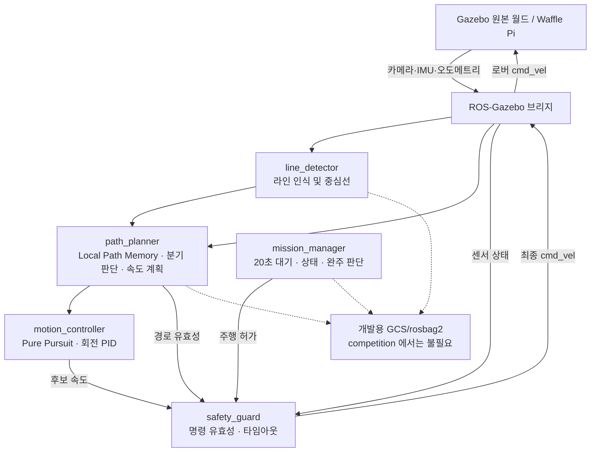
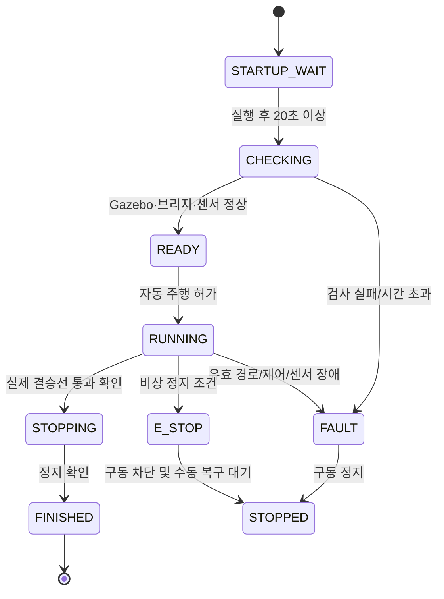

# ROS 2 Line Follower Rover — 프로젝트 개발·설계서

> **문서 버전:** v1.2 (핵심 설계 확정 + 바이브 코딩용 개발 체크리스트)  
> **작성일:** 2026-11-16  
> **개발 방식:** TDD (Test-Driven Development)  
> **우선 목표:** 공식 개인 프로젝트 평가 조건을 만족하면서 **라인 추종 거리를 최대화하고 목적지 도착 시 주행 시간을 단축**  
> **기준 문서:** `project1_line_follower_lab.pdf` (교수 제공 공식 과제 안내, 5쪽)  
> **구현 상태:** 아키텍처·알고리즘 기본안 확정 / 모델 성능·측정 임계값·실제 통합 시험 미완료

---

## 0. 이 문서의 적용 원칙

이 문서는 교수의 **공식 과제 조건**과 설계 논의에서 정한 **프로젝트 내부 개발 전략**을 구분한다. 문서에 적힌 전략을 모두 공식 평가 조건이라고 가정하지 않는다.

| 구분 | 의미 | 우선순위 |
|---|---|---|
| **[공식 필수]** | 과제 PDF에 명시된 조건 | 반드시 충족 |
| **[핵심 구현]** | 공식 과제를 안정적으로 완수하기 위해 본 프로젝트가 채택한 기능 | 제출용 기본 시스템에 포함 |
| **[개발 전용]** | 실험·기록·분석·재학습을 위한 기능 | 평가 실행에 의존시키지 않음 |
| **[확장 대비]** | 조교와의 대화 등으로 가능성만 제기되었거나, 실물 로봇 개발을 위한 기능 | 공식화되거나 기본 성능이 확보된 뒤 적용 |
| **[실측 후 확정]** | 장비·주행 실험 전에는 안전하게 수치화할 수 없는 설정 | 임의로 성능을 보장하지 않음 |

**우선순위 결정:** 평가용 최소 완성 시스템(MVP) → 공식 트랙 완주율·속도 개선 → 경량 딥러닝과 위치 추정 성능 검증 → 장애물 회피 및 실물 Jetson 확장. 추가 기능이 공식 과제의 안정성을 해치면 제출 프로파일에서 비활성화한다.

### 0.1 공식 조건과 내부 가정의 차이

- 공식 PDF에는 **장애물 회피**, **바퀴의 검은 선 횡단 시 감점**, **GCS·원격 제어**, **Jetson 사용 의무**, **실제 경기용 사전 지도 금지**가 명시되어 있지 않다. 이는 현재 제출의 공식 필수 조건으로 간주하지 않는다.
- 설계 합의에 따라 **사전 좌표·주행 시퀀스를 주입하지 않고 카메라에서 본 라인으로 주행**한다. 이는 공식 토픽 사용 제한과 일반화 목표를 고려한 **프로젝트 자체 원칙**이다.
- 공식 평가는 **조교 노트북의 ROS 2 Jazzy + Gazebo Harmonic** 환경에서 이루어진다. Jetson Orin Nano 4GB는 **향후 실물 확장 환경**이지 평가 실행을 전제한 필수 하드웨어가 아니다.
- 평가에서 완주 판정의 세부 기준은 PDF만으로 완전히 정의되지 않는다. 로봇 **중심이 결승선을 통과**한다는 기준은 앞선 설계 논의의 **내부 구현 기준**이며 실제 채점 기준과 같다고 단정하지 않는다.

---

## 1. 공식 과제 요구사항

### 1.1 실행·제출 조건 — 공식 PDF 1쪽

| ID | 공식 요구사항 | 수용 기준 |
|---|---|---|
| R-01 | TurtleBot3 **Waffle Pi** 제공 모델 사용 | 제공 모델 파일 변경 없음 |
| R-02 | **ROS 2 Jazzy, Gazebo Harmonic** 사용 | 지정 환경에서 정상 실행 |
| R-03 | `ros2 launch <패키지> <launch 파일>` **한 줄**로 Gazebo·ROS 연결·라인 추종 실행 | 추가 수동 터미널 명령 없이 실행 가능 |
| R-04 | Gazebo 구동 시간을 고려해 **라인 추종 알고리즘을 20초 뒤 시작** | 시작 전 구동 명령 미발행/0 유지, 대기 후 동작 |
| R-05 | 제공된 **로버 모델과 월드 변경 금지** | 원본 `worlds/`, `models/` 내용·해시 보존 |
| R-06 | **로버 카메라 영상**으로 선 인식 | 실제 입력은 `/camera/image_raw`를 브리지한 영상 |
| R-07 | 로버 제어에는 **로버 토픽만** 사용 | `/world/`로 시작하는 Gazebo 토픽·서비스(실제 위치, `set_pose` 등) 사용 금지 |
| R-08 | 제출물: **패키지 압축 파일, Docker 이미지 주소, 실행 명령어 한 줄** | 3종 누락 없이 제출 |
| R-09 | 제출 기한: **2026-11-22(일) 23:59** | 기한 내 최종본 업로드 |

> 실행 시점 해석: 제출용 런치는 **실행 후 20초 전까지 주행하지 않으며**, 그 이후에도 카메라·브리지 준비가 확인되어야 출발한다. 실제 채점에서 20초 기준점을 어떻게 측정하는지 통합 시험으로 확인한다.

### 1.2 공식 평가 방향 — 공식 PDF 1쪽

1. **조건 준수:** 위 실행·입출력·원본 보존 요구사항.
2. **추종 거리:** 로버가 선을 얼마나 많이 따라갔는가. **3회 중 최댓값**을 사용한다고 안내됨.
3. **주행 속도:** **목적지에 도착했을 때** 얼마나 빠르게 선을 따라갔는가. 내부적으로 완주 시간도 측정하지만, 공식 채점 산식·도착 시 속도 측정 방식은 추가 공지 전까지 추정하지 않는다.

공식 PDF는 감점 가중치·최종 세부 산식을 확정하지 않는다. 따라서 초기 개발의 실질 우선순위는 **탈선·중단 없이 멀리 주행 → 목적지 도착 → 도착 시간을 단축**이다.

### 1.3 트랙 사양 — 공식 PDF 2쪽

| 항목 | 내용 |
|---|---|
| 크기 | 22 cm 타일 15 × 15개, 전체 **3.3 × 3.3 m** |
| 라인 | **폭 2 cm**, 전체 약 **15.6 m** |
| 형태 | 직선, 직각 커브, 원형 커브, **교차 1곳** |
| 출발 | 2열 14행의 T자 표시, 로봇 초기 진행 방향 `+x` |
| 목적지 | 2열 2행의 T자 표시 |
| 언덕 | 13~15행, 4~9열, **높이 6 cm** |
| 언덕 구조 | 오르막 2칸 → 평지 2칸 → 내리막 2칸, 기울기 약 **7.8°** |

**핵심 기술 위험:** 언덕 위에서는 카메라의 지면 투영 관계가 평지와 달라진다. 평면 호모그래피 결과만 무조건 믿는 제어기는 경로 오차가 커질 수 있다. 이미지 공간의 라인 연결성과 IMU 피치 변화에 대한 강건성을 반드시 시험한다.

공식 트랙 그림은 **개발 테스트 설계 및 회귀 상황 파악**에만 사용한다. 그림에 그려진 전체 좌표나 특정 회전 순서를 평가 실행 코드에 상수로 넣지 않는다.

### 1.4 제공 로봇·입출력 — 공식 PDF 3~5쪽

| 항목 | 제공 사양 |
|---|---|
| 로봇 | TurtleBot3 Waffle Pi, 차동 구동 |
| 크기 | **274 × 306 × 140 mm** |
| 바퀴 반경 / 간격 | **33 mm / 287 mm** |
| 카메라 | **640 × 480, 30 Hz**, 수평 화각 **62.2°**, 전방 수평 설치 |
| 카메라 장착 | 차축에서 전방 **76 mm**, 바닥에서 **103 mm** |
| IMU | **200 Hz** |
| LiDAR | 센서 기능 제거, 외형만 유지 |
| Gazebo 영상 | `/camera/image_raw` — `gz.msgs.Image` |
| Gazebo 관성센서 | `/imu` — `gz.msgs.IMU` |
| Gazebo 오도메트리 | `/odom` — `gz.msgs.Odometry` |
| Gazebo 속도 명령 | `/cmd_vel` — `gz.msgs.Twist` |

공식 자료는 `ros_gz_image` 및 `ros_gz_bridge` 사용을 안내한다. `GZ_SIM_RESOURCE_PATH`에 제공 `models/` 경로를 지정하여 월드를 로드한다. 제공 수업 이미지 `rp/ros2:jazzy-lab`에서 실행 확인된 것으로 안내되어 있다.

---

## 2. 개발 목표 및 범위

### 2.1 1차 목표: 평가용 최소 완성 시스템 [공식 필수 + 핵심 구현]

- 카메라 영상만으로 **검은 라인을 인식**한다.
- 직선·코너·원형 곡선·언덕·교차에서 **연속 추종**한다.
- 카메라 바로 앞 사각지대에서는 **실제로 본 짧은 경로**를 오도메트리로 갱신해 추종한다.
- 실시간 속도·제동 여유·경로 신뢰도를 고려해 가능한 한 빠르게 달린다.
- 결승점 후보를 감지하되 출발 표시와 혼동하지 않고, 로봇 중심의 통과를 확인한 뒤 정지한다(내부 기준).
- 1개 `ros2 launch`로 실행하고 20초 이전 주행을 차단한다.
- GCS나 Wi-Fi 연결 없이 독립 동작한다.

### 2.2 2차 목표: 성능 개선 [조건부 핵심 구현]

- **라인 검출 딥러닝 ①:** Fast-SCNN 기반 경량 Semantic Segmentation을 초기 모델로 채택한다. C++ OpenCV 후처리로 중심선·코너·교차 연결 그래프를 산출한다.
- **경로 평가 딥러닝 ②:** `path_planner` **내부**에 경량 MLP Ranking 모델(초기 후보: 입력 특징 → 64 → 32 → 경로 점수)을 포함한다. 모델 출력만으로 주행하지 않고 기하·안전 제약을 먼저 적용한다.
- **Local Path Mapper + Memory:** 현재 주행에서 **실제로 관측한** 선분만 단기 경로 그래프로 저장한다. 관측 상태와 과거 관측의 위치 추정 상태를 분리한다.
- **경사로와 사각지대:** 오도메트리·IMU를 이용한 상태 추정(EKF 도입 가능)으로 이미 관측한 라인의 현재 상대 위치를 추적하고, 신뢰 구간에서만 제한적으로 추종한다.
- **경로 계획과 제어:** Pure Pursuit + 회전 PID 및 곡률·관측 거리·제동 가능성 기반 속도 제한.
- **GCS/ROS Bag 분석:** 개발 중 실시간 로컬 맵, 주행 좌표, 후보 경로, 카메라 및 기록 재생을 사용해 실패 구간을 찾고 재학습한다.

**배포 결정:** 두 모델은 **Python/PyTorch로 학습**, 주행 시에는 **C++ 추론 백엔드(평가 노트북에서 ONNX Runtime CPU, 실물 Jetson에서 TensorRT)** 사용을 목표로 한다. 단, Fast-SCNN 및 MLP는 *초기 채택 후보*이지 평가 CPU의 속도·정확도가 검증된 완성 모델이 아니다. **C++ OpenCV 기준선 인식 + 규칙 기반 후보 평가를 폴백으로 반드시 유지**한다. 비교 실험에서 딥러닝이 평가 점수에 도움이 되는 경우에만 최종 `competition`에서 활성화한다.

### 2.3 공식 과제 밖 확장 [확장 대비]

- **고정 장애물**의 인식, 좌·우 회피 후보 비교, 라인 재복귀.
- 라인과 장애물 **서로 다른 딥러닝 모델 2개**, Jetson Orin Nano 최소 **4GB**에서 TensorRT C++ 추론.
- 기존 카메라 모듈·위치 유지, Jetson에 CSI 리본 케이블 직접 연결(실물 호환성 실측).
- 바퀴가 검은 기준선을 **횡단하는 사건**의 검출·최소화(대화에서 나온 가능한 채점 규칙에 대한 대비, 공식 확인 전 비필수).
- 실제 로봇의 **독립 물리적 E-STOP 및 구동부 Watchdog**.
- 장애물 없이 평가하는 기본 월드에 장애물을 **추가하거나 원본을 변경하지 않는다**.

---

## 3. 실행 프로파일과 배포 원칙

### 3.1 프로파일

| 프로파일 | 장소 | 포함 | 제외/비활성 |
|---|---|---|---|
| `competition` (**기본**) | 조교 노트북 + Docker + Gazebo | 원본 월드, 브리지, 필수 ROS 2 노드, 자체 시작/종료, 안전 제어 | GCS·원격 명령 의존성, 로깅으로 인한 주행 지연, Jetson 전용 라이브러리 의존성, 장애물 회피 |
| `dev_sim` | 개발 PC/Gazebo | 기본 실행 + 진단 토픽 + 선택적 rosbag2 + GCS 시각화 | 공식 월드 파일 수정 |
| `replay` | 개발 PC 오프라인 | 기록 재생, 인식·플래너 비교, 테스트 분석 | **실제 `/cmd_vel` 구동 연결** |
| `real_jetson` | 실물 TurtleBot3 Waffle 계열 + Jetson | C++/TensorRT, 실제 카메라·오도메트리, 물리 안전장치 | 평가용 Gazebo 및 월드 좌표 사용 |

기본 제출 프로파일은 **추가 장비·인터넷·Wi-Fi·외부 GCS 없이** 구동되어야 한다. `dev_sim`, `replay`, `real_jetson`은 공식 제출물 안에서 필수 실행 경로가 아니다.

### 3.2 한 줄 실행 인터페이스 [확정]

```bash
ros2 launch line_follower_bringup competition.launch.py
```

런치는 내부적으로 다음을 자동 수행한다.

1. 제공 `models/`의 리소스 경로 설정.
2. 제공 `worlds/line_track.sdf`를 **수정 없이** Gazebo Harmonic으로 실행.
3. 이미지, `/imu`, `/odom`, `/cmd_vel`에 필요한 ROS-Gazebo 브리지 실행.
4. 인식·계획·제어·안전·미션 노드 실행.
5. 기동 이후 20초와 센서 준비 여부를 확인하고 자율 주행 허가.
6. 완주 또는 장애 시 속도 0 명령을 수행하고 미션 종료.

**주의:** 위 명령은 최종 패키지의 **목표 실행 계약**이며, 아직 작성·검증 완료된 실행 파일이라고 주장하지 않는다. Docker는 이미지 제공과 패키지 의존성 고정을 담당한다.

### 3.3 패키지 원본 불변성

`worlds/line_track.sdf`, `models/`의 모든 원본 파일은 제출 시 원본 그대로 유지한다. 모델 경로를 찾기 위한 환경변수·런치 설정은 변경 가능하되, 월드나 로버 모델의 내용은 바꾸지 않는다. 테스트용 추가 환경은 별도의 작업 공간에서 생성하며 제출 기본 월드와 섞지 않는다.

---

## 4. 시스템 아키텍처

### 4.1 핵심 데이터 흐름



**경로 계획과 구동 명령의 최종 발행 책임을 분리**한다. 다른 애플리케이션 노드는 Gazebo 구동 토픽으로 직접 속도 명령을 보내지 않는다.

### 4.2 노드 책임

| 구성 요소 | 필수 역할 | 비고 |
|---|---|---|
| `mission_manager` | 시작 지연, 준비 검사, 미션 상태, 완주 판정, 구동 허가 | 경쟁 실행은 **자동 시작**. GCS 명령 불필요 |
| `line_detector` | Fast-SCNN 라인 세그멘테이션(C++ 추론) + OpenCV 중심선·교차/코너 후처리 | 초기 딥러닝 후보, OpenCV 기준선 폴백 |
| `path_planner` | Local Path Mapper/Memory, 후보 특징 생성, **내부 MLP 경로 평가**, 기하 검증, 목표점·속도·회전 방식 | MLP 실패·지연 시 **규칙 기반 평가 폴백** |
| `motion_controller` | Pure Pursuit, 정지 후 회전 PID, 속도·각속도 후보 산출 | 최종 `/cmd_vel` 발행 금지 |
| `safety_guard` | 주행 허가·신선도·속도·가속·상태 검사, 최종 명령 발행 | **유일한 구동 명령 발행자** |
| `obstacle_detector` | 장애물 영역 추정 | 확장용: 기본 평가에서 실행하지 않음 |
| `gcs_bridge`, `gcs_command`, `gcs_mission_manager` | 개발용 통신, 미션/기록 명령, 상태·맵 좌표 수신, 화면/재생 | 개발 전용; 공식 평가 의존 금지 |
| `run_analyzer` | rosbag 재생·실패 구간 추출·평가 비교 | 개발 전용 분석 모듈 |

독립 안전 기능이 완전히 보장되려면 실제 구동 하드웨어의 명령 타임아웃도 필요하다. 시뮬레이션 평가에서는 `safety_guard` 및 브리지/프로세스 종료 상황을 테스트한다. 이를 물리 E-STOP과 동일하다고 보지 않는다.

### 4.3 최소 패키지 구성안

```text
line_follower_ws/
  src/
    line_follower_interfaces/   # 필요한 맞춤 메시지·상태 타입
    line_follower_perception/   # line_detector, 인식 백엔드
    line_follower_navigation/   # path_planner, local mapper/memory, MLP evaluator, pose_estimator
    line_follower_control/      # motion_controller, safety_guard
    line_follower_mission/      # mission_manager, finish 판단
    line_follower_bringup/      # competition/dev/replay launch, config
    line_follower_tests/        # TDD 유닛·통합·회귀 시험
  assets/
    worlds/                     # 제공 원본 (수정 금지)
    models/                     # 제공 원본 (수정 금지)
  tools/
    gcs/                        # gcs_bridge, gcs_command, gcs_mission_manager, UI
    bag_analyzer/               # rosbag 재생·실패 분석 도구
  docs/
    design.md
    test_plan.md
    deployment.md
  Dockerfile
  README.md
```

실제 구현 시 불필요한 프로세스 간 복제 비용이 크면 컴포저블 노드나 내부 모듈 결합을 적용할 수 있다. 단, 논리적 책임과 각 인터페이스의 테스트 가능성은 유지한다.

---

## 5. ROS 2 입출력 및 시간 계약

### 5.1 공식 로버 토픽 브리지

| ROS 2 측 | 방향(평가 구성) | Gazebo 측 | 목적 |
|---|---|---|---|
| `/camera/image_raw` (`sensor_msgs/msg/Image`) | Gazebo → ROS | `gz.msgs.Image` | 라인 검출 입력 |
| `/imu` (`sensor_msgs/msg/Imu`) | Gazebo → ROS | `gz.msgs.IMU` | 자세·피치·회전 감시 |
| `/odom` (`nav_msgs/msg/Odometry`) | Gazebo → ROS | `gz.msgs.Odometry` | 상대 이동량 |
| `/cmd_vel` (`geometry_msgs/msg/Twist`) | ROS → Gazebo | `gz.msgs.Twist` | 최종 속도 명령 |

브리지 토픽과 메시지 변환이 실제 제공 모델과 일치하는지 `README.md` 및 실행 시험으로 검증한다. **`/world/` 접두 토픽·서비스는 구독·호출·명령에 사용하지 않는다.**

### 5.2 애플리케이션 내부 인터페이스 — 확정 논리 스키마

다음은 **설계 계약**이며 아직 실제 `.msg`, `.srv` 파일을 구현한 것은 아니다.

| 토픽/이벤트 | 공급 → 소비 | 최소 내용 |
|---|---|---|
| `/perception/line` | `line_detector` → `path_planner` | `capture_stamp`, `frame_id`, 세그멘테이션/중심선, 교차·선분 ID, 연결 후보, 관측 유효범위, 품질 |
| `/perception/status` | `line_detector` → `safety_guard`, 개발 분석기 | 촬영 지연, 최신 프레임, 추론/후처리 지연, 모델/폴백 상태 |
| `/localization/estimate` | 위치 추정 모듈 → `path_planner`, 분석기 | `stamp`, `odom` 기준 pose(위치·방향), 필요한 자세(피치), 불확실성, 건강 상태 |
| `/path/observed_graph` | `path_planner` → 개발 분석기/GCS 수집 경로 | 직접 관측 선분 및 연결 관계, 관측 시각·좌표계·신뢰도 |
| `/path/local` | `path_planner` → `motion_controller` | 현재 로봇 기준 유효 경로, 각 선분의 관측/기억 상태, 목표점·목표 방향, 속도 상한 |
| `/path/candidates` | `path_planner` → 개발 분석기 | 각 분기 후보의 관측 길이, MLP 점수, 기하 검증 결과, 선택 이유 |
| `/path/status` | `path_planner` → `safety_guard`, 분석기 | 경로 유효성, 불확실성, 모드, 검증된 잔여 거리, MLP 상태 |
| `/control/cmd_vel_candidate` | `motion_controller` → `safety_guard` | 선속도·각속도 후보, 계산 시각·유효 기한 |
| `/mission/state` | `mission_manager` → 각 노드/개발 GCS | 상태, 자동 시작 허가, 완료/중단 사유, `run_id` |
| `/safety/status` | `safety_guard` → 개발 분석기 | 명령 승인/차단, 속도 제한 및 정지 이유 |
| `/cmd_vel` | **`safety_guard`만** → Gazebo 브리지 | 최종 속도 명령 |

**데이터 계약:** 관측 경로 점은 `(x,y)`와 `frame_id`(예: `odom`, `base_link`), 실제 `capture_stamp`, `source={OBSERVED,MEMORY_UPDATED,UNKNOWN}`, `segment_id`, `confidence`, `uncertainty`, `valid_until`을 구분한다. `UNKNOWN`은 확정 경로로 컨트롤러에 보내지 않는다. MLP 출력은 **후보간 비교 점수**이며 무조건 참/거짓 확률이라고 해석하지 않는다. 좌표 생성 과정에서 현재 카메라 이미지의 결과와 과거 추정 결과를 덮어쓰지 않는다.

**시간·동기화:** 카메라 촬영 시각에 대응하는 오도메트리/IMU 값을 사용하고, 보간 가능한 시간 범위를 벗어나면 측정을 폐기한다. 모든 실시간 노드는 새 입력을 기다리는 동안 안전 경로의 제어·타임아웃 루프를 블로킹하지 않는다.

### 5.3 반드시 지킬 불변 조건

1. 영상 판단은 **영상 촬영 시각**을 기준으로 오도메트리와 연결한다. 콜백 수신 시각을 촬영 시각으로 대체하지 않는다.
2. `use_sim_time`을 사용하며 `/clock` 처리와 rosbag 재생 시계 충돌을 방지한다. `/clock`은 시뮬레이션 시간 관리용이고 로봇 제어의 실제 위치 소스로 사용하지 않는다.
3. 신선하지 않은 영상·경로·제어 후보는 폐기한다. 오래된 프레임을 무한히 쌓지 않는다.
4. `mission_manager`의 주행 허가가 없으면 최종 속도는 0으로 제한한다.
5. `safety_guard` 이외의 노드는 `/cmd_vel`에 게시하지 않는다.
6. `competition` 프로파일에서는 GCS·Wi-Fi·rosbag 기록 프로세스가 정지해도 제어 파이프라인에 영향이 없다.

주기·QoS·버퍼 길이·타임아웃은 시스템 성능에 직접 영향을 주므로 실측과 TDD로 확정할 **파라미터**로 둔다. GCS 2Hz 표시 주기는 **개발용 화면의 합의값**이며 안전 감시나 제어 주기와 무관하다.

---

## 6. 인식 시스템 설계

### 6.1 Line Detector — Fast-SCNN + C++ OpenCV [초기 채택]

| 단계 | 처리 | 산출물 |
|---|---|---|
| 입력 | 로봇 RGB 카메라 `640×480`, 영상 촬영 시각 | `sensor_msgs/Image` |
| C++ OpenCV 전처리 | 이미지 변환, 조명/대비 대응, ROI 구성 및 정규화 | 모델 입력 텐서 |
| **Fast-SCNN 추론** | 검은 라인 / 배경 세그멘테이션 | 라인 확률/마스크 |
| C++ OpenCV 후처리 | 잡음 제거, 연결성·중심선·선분 그래프·교차/코너 추출 | 관측된 라인 그래프 |
| 카메라/자세 연계 | 지면 투영이 유효한 영역의 좌표 변환 및 품질 판정 | `base_link` 라인 좌표, 관측 범위 |
| ROS 2 출력 | 시각·좌표계·품질·선분 연결을 유지 | `/perception/line` |

**필수 보존 조건:** 폭 **2cm**의 얇은 라인이 사라지지 않도록 입력 해상도를 먼저 비교한다. 직각 코너를 둥글게 왜곡하거나 교차 선분들을 인접성만으로 오연결하지 않는다. 투영이 유효하지 않은 픽셀/언덕 구간은 3D 지면 좌표를 억지로 확정하지 않고 영상상의 관측으로 유지한다.

**OpenCV는 C++ API**를 이용한다. Fast-SCNN 학습은 Python/PyTorch, 실제 ROS 2의 전처리·추론·후처리는 C++로 수행한다. 단, 평가 노트북에서 ONNX Runtime CPU 추론의 실제 속도를 확인한 뒤 활성화한다. **폴백:** 동일 출력 스키마를 갖는 C++ OpenCV 이진화/연결성 기준선 인식.

### 6.2 Line Detector 학습 및 비교 실험

- 데이터: Gazebo 생성 데이터와 실제 촬영 데이터. **제공 공식 월드는 수정하지 않고**, 별도 실험 환경/데이터에서 다양성을 확보한다.
- 라벨: 라인 **픽셀 마스크**와 사람이 검토한 코너/교차 연결 사례. 선분 그래프는 후처리의 검증 지표이며 세그멘테이션 정답과 구분한다.
- 비교: Fast-SCNN vs OpenCV 기준선. 후보 비교 모델로 LR-ASPP MobileNetV3 등은 **여유 있을 때** 검토한다.
- 평가: 라인 누락/오검출, 픽셀·중심선 오차, 코너 구조 보존, 분기 연결 오류, CPU RAM·FPS·카메라→제어 명령 전체 지연, 실제 3회 주행 결과.
- 모델 해상도·입력 크기·FP32/기타 정밀도는 사전 고정하지 않고 측정으로 결정한다. **TensorRT는 실물 Jetson 프로파일에만 적용**한다.

### 6.3 언덕, 카메라 사각지대, 인식 거리 측정 [필수 설계]

공식 과제의 로버 카메라는 **전방 수평**, 위치는 **차축 전방 76mm/지면 상부 103mm**다. 언덕은 높이 **6cm**, 경사 약 **7.8°**다. 가까운 라인 소실이 반드시 발생한다고 단정하지 않고 실제 영상을 통해 그 조건을 식별한다.

- 평지·오르막 진입·오르막·상단 전환부·내리막·출구에서 **가장 가까운/먼 유효 라인 관측 거리**를 따로 측정한다.
- 영상에서 검출된 라인이라도 **경사 변화 때문에 고정 평면 변환이 틀릴 수 있는 구간**은 좌표 품질을 낮게 분류하고 IMU의 피치(필요 시 롤)를 반영한다.
- 관측 중인 라인은 계속 갱신한다. 바로 앞이 가려져도 **이미 실제로 관측했던 선분만** Local Path Memory에서 현재 위치로 옮긴다.
- 그동안 로봇 위치/방향 추정 불확실성이 증가하므로 허용 속도와 기억 경로의 유효 거리를 축소한다. 다시 관측된 라인과 메모리가 일치할 때만 정상 추종으로 복귀한다.
- **미관측 새 코너·새 분기**는 EKF만으로 생성할 수 없다. 충분한 유효 경로가 없으면 감속 후 정지한다.

측정표는 §14.2에 두며, 수치·임계값은 사용자가 시뮬레이터/실물에서 직접 측정한 후 설정 파일에 반영한다.

### 6.4 교차·분기 인식의 책임 분리

`line_detector`는 교차/분기 **후보와 그 주변의 선분·연결 관계를 관측한 만큼만 보고**한다. 실제로 어느 방향을 주행할지는 결정하지 않는다. `path_planner`의 **Local Path Mapper → MLP 후보 평가 → 기하/안전 검증 → 최종 경로 결정** 순으로 수행한다.

공식 월드에는 **교차 1곳**이 있다. 교차 지점 도달 전에 **관측 가능한 여러 선분을 최대한 확보**하는 정책을 사용하지만, 한 번의 영상으로 전체 트랙의 모든 방향을 볼 수 있다고 가정하지 않는다.

## 7. Local Path Memory 및 Path Planner

### 7.1 내부 모듈 구성 [기본안 확정]

`path_planner`는 **하나의 ROS 2 C++ 노드** 안에 다음 모듈을 둔다. MLP와 EKF는 별도 노드 수를 늘리지 않고 독립 테스트가 가능한 컴포넌트로 만든다.

| 내부 모듈 | 책임 | 실패 시 처리 |
|---|---|---|
| `LocalPathMapper` | 직접 관측한 선분을 그래프로 구성, 관측/추정 구분 | 미관측을 확정 경로로 게시하지 않음 |
| `LocalPathMemory` | `odom`에 단기 기억 저장, 시간·관측 출처·불확실성 관리 | 만료/오차 증가 시 즉시 사용 중단 |
| `PoseEstimator` | `/odom`, `/imu`로 로봇 자세·상대 이동량 추정; 성능 필요 시 EKF 적용 | 건강 상태 저하 시 메모리 추종 금지 |
| `CandidateFeatureBuilder` | 분기별 연결성·곡률·전방 관측 길이 등 특징 산출 | 누락 데이터 마스킹, 입력 유효성 검사 |
| `MLPPathEvaluator` | 후보의 주행 가능성을 상대 점수로 평가 | 타임아웃/모델 부재 시 규칙 기반 점수 사용 |
| `TrajectoryPlanner` | 기하 검증, 후보 선택 잠금, 목표점·속도 상한·회전 모드 결정 | 안전한 후보 없으면 감속/정지 |

### 7.2 Local Path Memory — 좌표·출처·유효성

현재 **주행 중 카메라가 실제로 관측한 선분만** 제한된 크기로 보관한다. 저장 좌표계는 `odom`, 제어용 출력은 `base_link`, 카메라 관측 기준은 `camera_link`다. `odom`에 저장해도 이동 추정의 드리프트가 사라지는 것은 아니다.

| 필드 | 내용 |
|---|---|
| `position / segment_geometry` | 실제로 관측한 라인 지점·선분 |
| `capture_stamp` | 영상 촬영 시각 |
| `frame_id` | 좌표계 (`odom` 등) |
| `source` | `OBSERVED` / `MEMORY_UPDATED` / `UNKNOWN` |
| `confidence / uncertainty` | 인식 품질·상대 위치 오차 |
| `segment_id / connectivity` | 직각·원형 커브·교차 분기의 그래프 연결 |
| `valid_until / validity` | 실시간 사용 가능 여부 |

새 미션 시작·완주·장애 리셋 때 초기화하고, 오래된/지나간/과도하게 불확실한 선분은 폐기한다. 사전 트랙 전체 좌표, 특정 코너 위치, 고정 회전 순서는 로드하지 않는다.

### 7.3 EKF 기반 위치 추정과 '기억 경로' 예측

**핵심 구분:** EKF는 **로봇 상태**를 추정하는 필터이지, 보이지 않는 **새 라인을 만들어내는 모델이 아니다**. 이미 카메라가 본 라인의 `odom` 좌표를 EKF/오도메트리로 갱신한 현재 `base_link` 위치로 투영하여 제어한다.

1. 카메라가 라인을 볼 때 촬영 시각의 자세와 라인을 함께 저장한다.
2. `/odom`을 기본 상대 이동량 입력으로, `/imu`의 각속도·방향(특히 경사로 피치)을 검증 가능한 방식으로 활용한다.
3. **초기 베이스라인:** 휠/시뮬레이터 오도메트리 + IMU 피치 보정. **EKF 활성화 조건:** 경사로·회전의 위치/방향 예측오차를 실험했을 때 개선이 확인되는 경우. 오도메트리가 이미 필터링된 신호일 수 있으므로 상관된 센서 값을 독립인 것처럼 중복 융합하지 않는다.
4. 가까운 라인이 일시적으로 소실되면, 저장된 관측 선분을 현재 기준으로 변환하고 불확실성을 증가시킨다.
5. 유효한 관측 선분 길이와 정지 가능 거리 안에서만 속도를 제한하여 추종한다. `UNKNOWN`으로 표기한 미관측 구간을 향해 무제한 외삽하지 않는다.
6. 라인이 다시 보이면, 현재 관측과 기억 선분의 위치·방향·연결성을 비교해 일치할 때만 경로 기억을 갱신한다.
7. 오차·유효 거리·처리 지연 중 하나라도 허용값을 넘으면 `SLOWDOWN` 또는 `STOPPING`.

**경사로 주의:** 2D EKF만으로 카메라 피치/경사면의 3D 투영 문제가 자동 해결되지는 않는다. IMU 자세와 현재 바닥면 모델/투영 유효성 검사를 별도로 두며, 정확한 경사면 좌표 계산이 불가능한 경우 영상 좌표 기반 추종 또는 기억 경로 제한 주행으로 전환한다.

### 7.4 교차로에서 '맵을 충분히 읽고' 판단하는 절차

교차로를 발견한 즉시 무조건 회전하지 않는다. **현재 주행에서 관측 가능한 여러 후보 선분과 단기 기억을 충분히 수집하고**, 관측 한계 안에서 안전한 경로를 선택한다.

1. `line_detector`의 그래프에서 현재 진입 선분과 교차·분기 후보를 구분한다.
2. 진행하면서 업데이트되는 관측 그래프를 합치고, 실제 관측된 각 후보의 유효 길이·연결성·방향을 비교한다.
3. 현재 속도로 충분한 판단 거리가 확보되지 않으면 **미리 감속**하여 추가 관측 기회를 확보한다.
4. 먼저 로봇의 운동학적 회전 가능성, 코너 절단 위험, 관측 범위·안전 여유를 검사해 불가능한 후보를 제외한다.
5. **MLP의 상대 점수 + 규칙 기반 점수**를 사용해 안전한 후보를 비교한다(관측 연속성, 곡률, 관측 거리, 목표 방향 변화, 예상 통과 시간).
6. 방향을 선택한 뒤에는 **선택 잠금/해제 조건**으로 불필요한 좌우 전환을 방지한다. 실제 새 관측이 선택 경로를 반박하거나 안전이 위협받는 경우만 재계획한다.
7. 전체 트랙의 미래 연결이나 최단 완주 경로는 관측하지 않았으므로 **보장할 수 없다**. 읽을 수 없는 구간은 확정 경로로 저장하지 않는다.

**기본 우선순위:** 안전성과 라인 연속성 → 관측 근거의 충분성 → 후보의 국소 주행 비용(방향 변화·곡률·예상 시간). 공식 평가에서 분기의 정확한 방향이 별도로 지정되면 최신 공식 지침에 맞춰 정책을 수정한다.

### 7.5 경량 MLP Path Evaluator [초기 후보 채택]

- **위치:** 별도 ROS 2 노드가 아니라 `path_planner` 내부 C++ 모듈.
- **구조 초기안:** 모든 경로 후보에 동일한 MLP 적용, `features → 64 → 32 → candidate_score`. 정규화·마스킹·입력 스키마를 모델과 함께 버전 관리.
- **특징 후보:** 현재 진행 방향과 후보 선분의 각도 차, 관측된 연결성, 관측 길이, 곡률·급변 구간, 검출 품질, Local Path Memory와 일치도, 위치 오차, 유효한 전방 거리, 경사 구간에서의 투영 품질, 필요 시 후보 예상 조향 비용.
- **라벨:** 실제 테스트에서 검토된 **주행 가능/불가능, 연결 일치/불일치, 후보 간 선호 순서**를 사용한다. 카메라가 보지 않은 미래 최적 경로를 정답으로 제공하거나 공식 월드 전체 좌표를 추론 입력에 사용하지 않는다.
- **출력:** 후보별 비교 점수와 모델 상태. 점수는 **일반화된 성공 확률이라고 보장하지 않는다**.
- **안전 게이트:** 입력 무효·지연·모델 불확실·후보 기하 불가 시 MLP의 선호를 무시하고 규칙 기반 판단 또는 정지.
- **채택 실험:** **규칙 기반만 vs MLP 보조**를 같은 Bag 오프라인 평가 및 Gazebo 주행 3회 이상에서 비교한다. 실제 추종거리/완주 성능 향상이 없으면 제출용에서 비활성화하고 학습 데이터를 보강한다.

### 7.6 주행 모드·속도 계획

| 내부 제어 모드 | 진입 조건 | 기본 처리 |
|---|---|---|
| `VISION_TRACKING` | 현재 관측·투영 유효 | Pure Pursuit 정상 추종 |
| `MEMORY_TRACKING` | 가까운 라인이 소실되었으나 충분히 유효한 기억 선분 존재 | 상대 위치 추정으로 제한 속도 추종 |
| `REACQUIRING` | 라인이 다시 관측됨 | 기억 경로와 일치 검증, 급격한 방향 전환 방지 |
| `SLOWDOWN` | 경로 불확실성·곡률·감속 필요 증가 | 전방 검증 거리/제동 거리 기준 감속 |
| `ROTATE_IN_PLACE` | 검증된 코너 방향이 있고 연속 회전이 위험 | 먼저 정지한 뒤 PID 방향 정렬 |
| `STOPPING`/`STOPPED` | 유효 경로 상실·안전 장애·완주 | 안전 정지·정지 유지 |

속도 상한은 구동부 한계, 곡률, 오차, **직접 관측한 유효 경로 길이+충분한 신뢰도의 기억 선분 길이**, 추정 불확실성, 영상/추론/제어 지연과 제동 거리의 교집합으로 결정한다. **유효하고 정지할 수 있는 범위를 넘어 가속하지 않는다.** 실제 가속도·look-ahead·최대 속도·상태 임계값은 Gazebo에서 검증한 뒤 파라미터로 확정한다.

### 7.7 바퀴 궤적 분석 [개발 지표/확장]

차동구동 바퀴 간격 287mm를 사용해 코너 회전 시 좌·우 바퀴 예상 궤적을 계산할 수 있다. 바퀴의 검은 기준선 **횡단 횟수 감점은 공식 PDF의 확정 항목이 아니므로** 개발 관찰 지표/추가 대비로 분류한다.

## 8. Motion Controller 설계

### 8.1 채택한 하이브리드 구조 [핵심 구현]

- **기본 전진 추종:** Pure Pursuit.
- **급격한 방향 변경:** 조건이 적합하면 저속 연속 회전, 그렇지 않으면 **정지 후 회전 PID**.
- **로봇 구동:** 차동구동 `linear.x`, `angular.z` 후보 출력.
- **제어기 전환:** `path_planner`가 모드를 결정하고 `motion_controller`가 수행한다.

| 모드 | 동작 |
|---|---|
| `VISION_TRACKING` | 현재 관측 기반 Pure Pursuit |
| `MEMORY_TRACKING` | 유효한 과거 관측을 현재 좌표로 갱신해 제한 추종 |
| `REACQUIRING` | 새 관측과 기억 경로 일치 검사 후 정상 추종으로 전환 |
| `SLOWDOWN` | 불확실성·곡률 증가로 감속 |
| `ROTATE_IN_PLACE` | 선속도 0 확인 후 회전 PID |
| `STOPPING` | 안전 제한 하에서 정지 |
| `STOPPED` | 정지 상태 유지 |

Pure Pursuit가 직각 코너를 안쪽으로 잘라 지나가게 만들 수 있으므로, 목표점 선정 시 **연결 구조와 코너 기하를 보존**한다. 회전 PID에서도 로봇이 관측하지 못한 새 경로 방향을 추측하지 않는다.

### 8.2 제어기 종료 조건

- 목표점·경로 정보가 만료되거나 잘못되면 속도 후보 0.
- 모드 변경 중 경로·자세 불일치가 발생하면 멈추고 재평가.
- 제자리 회전은 목표 방향과 각도 오차의 상한을 적용하며 무한 회전하지 않음.
- 안정적인 추종이 확인될 때만 가속으로 복귀.

---

## 9. Mission Manager / Safety Guard

### 9.1 미션 상태 머신



`PAUSED`와 원격 시작/정지는 **개발용 운용 기능**으로만 둔다. 평가 기본 실행은 자동으로 주행을 시작하며 원격 GCS 명령을 기다리지 않는다.

### 9.2 안전 제어 불변 조건

- `safety_guard`만 최종 `/cmd_vel` 발행.
- 미션 시작 대기, 오류, 종료 때 0 속도 유지.
- 오래된 카메라 프레임, 추론·경로·제어 데이터, 오도메트리 상실을 감지.
- 과도한 선속도·각속도·가속도 변화 제한.
- 제어기나 `mission_manager` 종료 시 명령 중단이 안전 정지로 이어지는지 **실제 Gazebo에서 확인**.
- 물리적 E-STOP과 구동부 Watchdog은 **실물 Jetson 확장 시 필수 하드웨어 조건**이며, 시뮬레이션 코드만으로 이를 충족했다고 주장하지 않는다.

### 9.3 완주 판정

1. 카메라에서 결승점 **T자 표식 후보**를 찾는다.
2. 출발 위치의 T자 표식을 완주로 오인하지 않도록 출발 전후 상태를 관리한다.
3. 후보 표식의 관측 결과와 상대 이동량을 연결한다.
4. 내부 설계 기준상 **로봇 중심의 결승선 통과**를 확인한다.
5. 통과 후 안전하게 정지하고 `FINISHED`로 전이한다.

결승선의 **정확한 공식 판정 방식은 PDF에 상세히 정의되지 않았다.** 탐지 후보의 모양·방향·신뢰도, 중복 이벤트 차단 조건은 실제 카메라 테스트로 검증한다. 실물/시뮬레이터에서 확인하기 전에는 단순 T자 한 번 검출만으로 자동 종료하지 않는다.

---

## 10. 개발용 GCS · rosbag2 · 스마트폰 검증

### 10.1 GCS의 역할과 확정된 ROS 2 3노드 구조 [개발 전용]

GCS는 노트북에서 실행되는 **개발용 시각화/기록/분석 시스템**이다. 실제 평가 프로파일 `competition`에서는 GCS/원격 제어/Wi-Fi가 없어도 로버가 자동 주행한다.

| GCS 노드 | 담당 역할 | 데이터 관계 |
|---|---|---|
| `gcs_bridge` | 로버 측 ROS 2 진단 메시지의 중계, 연결/시간/구독 관리 | 로버 `mission_manager`의 상태·맵 스냅샷 전달. `ros_gz_bridge`와 다른 기능 |
| `gcs_command` | 개발 중 **미션 시작, ROS Bag 기록 시작/종료, KILL(소프트웨어 정지 요청)** | 미션 명령은 로버 `mission_manager`, Bag 명령은 개발용 recorder로 전달 |
| `gcs_mission_manager` | 로버 상태와 **실제 관측/기억/선택 경로 좌표** 수신·관리, 화면 갱신과 이벤트 타임라인 연결 | 경로의 진실 소스는 로버 `path_planner`; GCS는 시각화·진단만 수행 |

로버 `path_planner` → 로버 `mission_manager`의 **GCS용 요약/스냅샷 집계** → `gcs_bridge` → `gcs_mission_manager`의 흐름을 사용한다. **로버 `mission_manager`가 지도 자체를 생성하지 않는다.** 같은 데이터의 원본 상세 토픽은 ROS Bag으로 기록해 2Hz GCS 스냅샷의 손실 정보를 보완한다.

개발 명령에는 `request_id`, `run_id`, 발행 시각·승인/거부·실행 결과를 두고 **중복 요청을 재실행하지 않는다**. Wi-Fi 통신 장애는 개발용 GCS의 상태로 표시하되 **로버의 자동 주행에는 영향이 없도록** 한다. GCS의 KILL은 **통신이 가능한 경우에만 전달되는 소프트웨어 정지 요청**이며, 물리적 비상 정지 장치를 대신하지 않는다.

### 10.2 확정 UI 배치 — 4×4 레이아웃

가로·세로의 **논리적 4×4 그리드**에서 다음 영역을 사용한다(창 크기에 맞춰 반응형으로 구현).

| 그리드 영역 | 배치 | 내용 |
|---|---|---|
| **열 1~3, 행 1~3 (3×3)** | 주 지도·로봇 표시 | `odom` 좌표의 로봇 위치/방향, **실제 인식한 선분**, Local Path Memory의 갱신 경로, 선택 경로, 분기 후보·품질을 색상/범례로 구분 |
| **열 4, 행 1~2** | 명령 패널 | `미션 시작`, `ROS Bag 시작`, `ROS Bag 종료`, `KILL`, 미션/연결 상태 |
| **열 4, 행 3** | 카메라 | 터틀봇 RGB 영상 및 선택적 라인 오버레이, 원본 비율 유지 |
| **열 1~4, 행 4** | ROS Bag 타임라인 | 기록/재생 전환, 시점 탐색, 실패·감속·분기 이벤트 표시 |

**데이터 색상 구분:** 직접 관측(녹색), 기억 좌표로 갱신(청록/별도 실선), 계획 경로(파랑), 분기/불확실 후보(노랑 점선), 무효/미관측(숨김 또는 회색). 정확한 색 코드는 UI 구현 단계에서 정한다. 확대·축소·로봇 중심 추적을 지원한다.

**화면 갱신:** 미션 상태·로컬 맵 요약 **2Hz**를 기본값으로 두고, 카메라 영상은 수신/렌더링 가능한 별도 속도로 표시한다. 2Hz 화면 주기는 실제 주행 제어·딥러닝 추론 주기가 아니다. **GCS에는 누적 분석 맵**을 개발용으로 그릴 수 있지만 로버의 주행 판단에는 사전/누적 전체 트랙 경로를 주입하지 않는다.

### 10.3 ROS Bag 수집 · 재생 · 학습 데이터 관리

| 기록 | 사용 목적 |
|---|---|
| 원본 `/camera/image_raw` | 인식 실패 재현, 라벨 데이터 생성 후보 |
| `/imu`, `/odom`, `/localization/estimate` | 경사로 피치·상대 이동량·상태 추정 오차 비교 |
| `/perception/line`, `/perception/status` | 세그멘테이션·중심선·오인식/지연 검증 |
| `/path/observed_graph`, `/path/local`, `/path/candidates`, `/path/status` | 로컬 맵·분기 점수·계획 경로·기억 경로 사용 이유 분석 |
| `/control/cmd_vel_candidate`, `/cmd_vel` | 의도한 명령과 실제 구동 명령 비교 |
| `/mission/state`, `/safety/status` | 상태·완주/중단·안전 문제 이벤트 |

원본 기록에 `run_id`, 시간 기준(`use_sim_time`), 코드·모델·설정 버전, 테스트 환경을 함께 기록한다. GCS의 수동 메모/실패 태그도 같은 `run_id`와 시간축으로 연결한다. 기록 저장과 GCS 전송이 **평가 CPU의 라인 추종을 방해하지 않도록** 부하를 실험하고 `competition`에서는 비활성화 가능하게 한다.

**Replay 안전 규칙:** Bag 재생은 실제 로버 구동 `/cmd_vel` 브리지에 연결하지 않는다. 같은 입력에서 모델 개선 전후 인식/경로 선택을 비교하되, 바뀐 조향에 따른 *미래 카메라 영상/위치까지 동일하게 재현되는 것은 아니다*. 실제 주행 결과는 Gazebo 또는 실물 반복 시험으로 검증한다.

### 10.4 스마트폰 영상 검증 [개발 전용]

- 테스트 시 가능한 한 **동영상**으로 바퀴·라인·로봇 방향이 보이게 촬영한다.
- **전체 트랙/구간별/혼합 촬영 범위는 사용자가 실제 테스트 환경을 확인한 뒤 선택**한다.
- 영상 시각과 ROS Bag은 공통 이벤트 등으로 동기화한다. 보이지 않는 구간은 `판정 불가`로 기록한다.
- 스마트폰 영상은 시험·정답 확인 보조 자료로만 사용한다. 공식 실행·원격 제어에는 연결하지 않는다.

### 10.5 실패 구간 재학습·TDD 폐루프

```text
Gazebo/실물 시험 → rosbag2 원본 + (가능하면) 스마트폰 동영상
 → GCS의 지도·선택 경로·카메라·타임라인에서 문제 시점 선택
 → 실패 유형 확인(라인 누락/교차 오연결/경사 추정 오류/제어 지연)
 → 사람이 영상과 경로 연결에 대한 정답 라벨 검토
 → Fast-SCNN 픽셀 마스크 및 MLP 경로 후보 데이터 보강
 → 분리된 검증 셋에서 오프라인 회귀 테스트
 → 동일 구성으로 Gazebo에서 재주행해 추종거리·완주·속도 비교
```

성능 모델은 규칙 기반과 같은 시험 조건에서 비교한다. 특정 공식 월드의 전체 좌표/회전 순서를 학습 입력으로 주입하지 않는다.

## 11. TDD 검증 계획

### 11.1 개발 원칙

각 요구사항마다 **실패하는 테스트 작성 → 최소 구현 → 테스트 통과 → 리팩터링 → 회귀 테스트** 순서를 따른다. 개발 결과는 기능 유무가 아니라 **테스트 증거와 성능 수치**로 확인한다.

### 11.2 필수 테스트 매트릭스

| ID | 유형 | 테스트 상황 | 합격 조건 | 우선순위 |
|---|---|---|---|---|
| T-01 | 배포 | `ros2 launch` 한 줄 실행 | Gazebo·브리지·노드가 자동 기동 | **필수** |
| T-02 | 배포 | 원본 검증 | 제공 월드·로버 모델 변경 없음 | **필수** |
| T-03 | 안전/시작 | 실행 직후~20초 | 로봇이 주행하지 않음 | **필수** |
| T-04 | 시작 | 20초 이후·센서 준비 | 외부 GCS 없이 자율 시작 | **필수** |
| T-05 | 정책 | 코드·브리지·기록 토픽 검사 | `/world/` 기반 실제 위치·`set_pose` 미사용 | **필수** |
| T-06 | 인식 | 직선·곡선·직각 | 라인 연결 및 중심이 안정적으로 검출 | **필수** |
| T-07 | 인식 | 언덕 입구·정상·출구 | 잘못된 평면투영만으로 급조향하지 않음 | **필수** |
| T-08 | 경로 | 교차 1곳 | 잘못된 라인 점프·무한 회전 방지 | **필수** |
| T-09 | 경로 기억 | 코너 사각지대 진입 | 실제 관측한 코너 구조 유지, 시간·오도메트리 갱신 | **핵심** |
| T-10 | 경로 기억 | 신선도/오도메트리 오차 증가 | 잘못된 기억 경로로 계속 고속 주행하지 않음 | **핵심** |
| T-11 | 제어 | 연속 회전 → 제자리 회전 전환 | 급격한 가속·무한 회전 없이 정상 전환 | **핵심** |
| T-12 | 안전 | 카메라/경로/컨트롤러 중단 | 정해진 타임아웃 안에 0 속도 및 정지 처리 | **필수** |
| T-13 | 종료 | 출발 T 및 목적지 T | 출발 표식을 완주로 오인하지 않음 | **필수** |
| T-14 | 종료 | 결승선 통과 | 내부 기준에 따라 중심 통과 확인 후 정지 | **필수** |
| T-15 | 배포 | 조교 노트북에 준하는 CPU+Docker | Jetson/TensorRT·Wi-Fi·GCS 없이 기동·주행 | **필수** |
| T-16 | 회귀 | 같은 rosbag 입력 재생 | 모델/알고리즘 변경 전후 결과 재현·비교 가능 | **개발** |
| T-17 | 관측 | 스마트폰 + Bag 이벤트 비교 | 바퀴 횡단·실제 동작 기록 검토 가능 | **개발** |
| T-18 | 확장 | 장애물 검출·좌우 회피·복귀 | 별도 테스트 환경에서만 검증 | **확장** |
| T-19 | 인식/학습 | 2cm 라인에 대한 Fast-SCNN vs OpenCV | 라인 누락·코너 보존·CPU 지연·주행 결과 비교 기록 | **핵심** |
| T-20 | 경로/MLP | 동일 후보에 대해 규칙만 vs MLP 보조 | 유효한 후보 우선, 점수·선택 이유 재현, 이득 없으면 폴백 | **핵심** |
| T-21 | 경로/교차 | 교차로 전체 후보 중 일부만 관측 | 보이지 않는 분기를 확정하지 않고 감속·추가 관측 | **핵심** |
| T-22 | 경로/교차 | 후보를 선택한 직후 새 라인이 출현 | 불필요한 방향 진동 없음; 안전 문제가 있을 때 재계획 | **핵심** |
| T-23 | 추정/경사 | 오르막·상단·내리막에서 가까운 라인 소실 | 유효한 과거 관측만 상대 좌표 갱신; 불확실성 증가 | **핵심** |
| T-24 | 추정/재관측 | 기억 경로와 다시 관측된 라인 불일치 | 즉각 고속 추종으로 복귀하지 않고 검증·감속/정지 | **핵심** |
| T-25 | 추정/EKF | 휠 오도메트리만 vs IMU 보정 vs EKF | 측정 오차·처리 부담 비교, 개선이 검증된 방식 채택 | **핵심** |
| T-26 | GCS/통신 | 로버 상태 및 지도 스냅샷 2Hz 수신 | 3노드 역할 구분, 맵 좌표·프레임·시각 일치 | **개발** |
| T-27 | GCS/UI | 4×4 화면·Bag 조작·카메라 | 3×3 지도 및 우측 패널/영상, 하단 타임라인 정상 표시 | **개발** |
| T-28 | 안정성 | MLP 모델 파일 없음/추론 지연, 영상 결과 만료 | 규칙 기반 폴백 또는 안전 정지, 제어 루프 블로킹 없음 | **핵심** |

합격의 **구체적 숫자 기준**(픽셀 오차, 영상 신선도, 감속 거리, 미션 타임아웃 등)은 초기 실험으로 기준 성능을 측정한 뒤 테스트에 고정한다. 단, T-01~T-05의 공식 조건은 별도의 성능 실측을 기다리지 않는다.

### 11.3 성능 실험 프로토콜

1. 동일 Docker 이미지, 모델, 설정, 공식 월드로 평가한다.
2. 각 후보를 **3회 이상** 주행시키고 매회의 추종 거리·목적지 도착 여부·완주 시간을 기록한다.
3. 공식 평가의 **최대 추종 거리(3회 중 최대)**를 별도 보고한다.
4. 완주한 경우 **주행 시간**, 실패한 경우 **이탈/정지 위치와 원인**을 기록한다.
5. 변경 전후 동일 환경에서 비교하고 필요하면 반복 횟수를 늘려 변동성을 확인한다.
6. 인식·메모리·제어의 실패는 rosbag과 스마트폰 영상으로 원인을 다시 확인한다.
7. 실제 채점 세부 방식이 확인되면 지표 가중치를 조정하되, 이전 실험 원본은 보존한다.

**성능 우선순위:** 공식 요구사항 위반 0건 → 추종 거리 증가 → 목적지 완주 재현성 → 완주 시간 단축. 빠르지만 매번 탈선하는 설정을 최종본으로 선택하지 않는다.

---

## 12. 구현 단계 및 완료 게이트

### 단계 A — 실행 환경·공식 준수

- 제공 월드·모델을 수정하지 않고 Gazebo 기동.
- 카메라·IMU·오도메트리·속도 명령 브리지 확인.
- 한 줄 실행, 20초 대기, Docker 구조 확인.
- **게이트:** T-01~T-05 통과.

### 단계 B — 최소 라인 추종 베이스라인

- C++/OpenCV 라인 검출.
- 기본 경로점 생성 및 Pure Pursuit 추종.
- 안전 속도 제한, 직선·기본 곡선 주행.
- **게이트:** 공식 트랙에서 라인 추종 거리 측정 가능, 기본 결함 재현 가능.

### 단계 C — 핵심 경로 계획 고도화

- Local Path Memory와 **실제로 관측한 선분 그래프**, 오도메트리/IMU 시간 정합.
- 직각·원형 커브, **관측 가능한 교차 분기를 충분히 읽고 후보 비교**, 언덕·사각지대의 메모리 추종 및 재관측 처리.
- Pure Pursuit와 회전 PID의 모드 전환.
- 결승선 후보 감지 및 중심 통과 기준 종료.
- **게이트:** T-06~T-14, T-21~T-24 핵심 조건 통과, 공식 평가 환경에서 반복 주행.

### 단계 D — 성능 개선 및 기록 분석

- 개발용 rosbag2, GCS 실시간 화면·재생.
- 스마트폰 영상 비교(촬영 범위는 추후 확정).
- 실패 데이터셋 보강, **Fast-SCNN 및 내부 MLP 평가 모델**을 규칙 기반 베이스라인과 비교하고, **EKF 도입 효과** 검증.
- **게이트:** T-19~T-20, T-25~T-28; 개선 모델이 CPU/도커 기준으로 베이스라인보다 유리하고 재현 가능할 때만 `competition`에 적용.

### 단계 E — 제출 동결

- 공식 월드/모델 파일 해시 검증.
- Docker 이미지 빌드·깨끗한 환경에서 실행.
- 한 줄 명령만으로 3회 이상 통합 시험.
- 패키지 압축·Docker 이미지 주소·실행 명령·README 제출 준비.
- **게이트:** T-01~T-15, 3회 평가 기록 및 제출물 체크리스트 완료.

### 단계 F — 실물·장애물 확장 (제출 이후 또는 여유 있을 때)

- Jetson Orin Nano 4GB에서 라인/장애물 독립 모델 C++ TensorRT 추론.
- 기존 터틀봇 카메라·설치 위치 유지, CSI 연결 호환성 확인.
- 고정 장애물 좌우 자동 회피 및 안전한 라인 복귀.
- 실물 구동부 Watchdog·독립 E-STOP 구축.
- 공식 과제 원본 트랙이나 제출 안정성을 훼손하지 않는 별도 분기로 진행.

---

## 13. 리스크와 대응

| 리스크 | 위험 | 대응 |
|---|---|---|
| Jetson 전용 모델을 평가 노트북에 배포 | 실행 실패 | **CPU 작동 경로를 경쟁 기본 프로파일로 유지** |
| Gazebo 또는 브리지 지연 | 20초 시점에 영상 미준비 | 20초 대기 + 센서 준비 검사, 무명령 상태 유지 |
| 2cm 얇은 검은 선 검출 불안정 | 탈선·주행거리 감소 | ROI·연결성·시간적 필터·재현 테스트 |
| 언덕에서 지면투영 오차 | 급조향·라인 손실 | IMU 피치·투영 유효성, **유효한 과거 관측 선분의 상대 좌표 갱신**·속도 제한 |
| 교차에서 잘못된 선 선택 | 잘못된 경로로 진입 | 관측 가능 후보 충분히 수집, **세그먼트 그래프 + MLP 보조/규칙 평가**, 선택 잠금 |
| Pure Pursuit 직각 코너 절단 | 경로 오차 증가 | 코너 보존·감속·회전 PID 전환 |
| 영상·오도메트리 타임스탬프 불일치 | 과거 경로 갱신 오류 | 촬영 시각 기준 동기화, 만료/오차 검사 |
| ROS Bag/GCS로 CPU·I/O 포화 | 추론 및 제어 지연 | 개발 전용 분리, 기록 부하 시험 |
| EKF가 보지 못한 라인을 만들 수 있다는 오해 | 경사로에서 허위 경로를 따라감 | EKF는 로봇 pose만 추정, **관측 선분만** 메모리 추종 |
| 두 경량 모델의 CPU 추론 지연 | 조교 노트북에서 실시간성 부족 | Fast-SCNN/MLP **독립 비활성화 및 C++ 규칙 기반 폴백** |
| 결승 T와 출발 T 혼동 | 조기 종료 | 시작 상태 분리, 다중 관측, 통과 검증 |
| 추가 장애물 기능이 범위를 확대 | 제출 일정·안정성 악화 | 공식 평가 MVP와 별도 확장 관리 |
| 원본 월드 파일 수정 또는 `/world/` 활용 | 조건 위반 | 파일 해시·토픽 정책 정적 검사 |

---

## 14. 최종 확정 사항 / 미확정 사항

### 14.1 확정된 아키텍처·개발 원칙

- **공식 평가 최우선:** Waffle Pi, ROS 2 Jazzy/Gazebo Harmonic, 원본 월드 불변, 단일 launch, 20초 이후 주행, 카메라 인식, 로버 토픽만 사용.
- **C++ 기반 ROS 2 주행**(라인 전처리·후처리·경로 계획·제어·안전), 학습만 Python/PyTorch.
- **라인 모델:** Fast-SCNN 초기 후보 + C++ OpenCV 후처리, C++ OpenCV 기준선 폴백. 평가용 실행은 CPU ONNX 추론 가능 여부를 검증.
- **경로 판단 모델:** 경량 **MLP Ranking Network**를 별도 ROS 노드가 아닌 `path_planner` 내부 모듈로 배치. MLP 미작동 시 규칙 기반 평가.
- **교차:** 관측된 임시 그래프를 충분히 읽고 후보의 연결성·주행 가능성·관측 범위·국소 시간 비용을 평가. 사전 전체 지도/미관측 경로는 사용하지 않음.
- **언덕:** 카메라 가까운 라인 소실 시 `odom` 저장 경로와 로봇 위치 추정(IMU, 필요 시 EKF)을 활용하여 제한 추종. **EKF 자체가 미관측 라인을 예측하지 않음**.
- **Motion Controller:** Pure Pursuit + 정지 후 회전 PID; `safety_guard`만 최종 `/cmd_vel` 게시.
- **GCS:** 노트북 개발 전용 `gcs_bridge`, `gcs_command`, `gcs_mission_manager` 3노드, 화면은 **왼쪽 3×3 지도 / 오른쪽 위 명령 / 오른쪽 아래 카메라 / 아래 Bag 타임라인**.
- **기록·테스트:** ROS Bag 원본 및 GCS 이벤트, 실시간 모니터링·리플레이, 스마트폰 영상(촬영 범위 추후 결정), TDD 회귀 테스트.
- **평가 중 GCS/원격 조종 미사용**. Jetson Orin Nano 최소 4GB, 장애물 회피와 바퀴 횡단 이벤트는 별도 확장/검증.

### 14.2 직접 측정할 값과 측정 양식 [사용자 실측]

| 측정 항목 | 평지 | 언덕 진입/오르막 | 언덕 상단 | 내리막/출구 | 저장할 지표 |
|---|---|---|---|---|---|
| 가장 가까운 유효 라인 인식 거리 (m) | TBD | TBD | TBD | TBD | 평균·최악값·영상 프레임 |
| 가장 먼 유효 라인 인식 거리 (m) | TBD | TBD | TBD | TBD | 평균·최악값·영상 프레임 |
| 코너 최초 유효 인식 거리 (m) | TBD | TBD | TBD | TBD | 카메라 stamp/로봇 속도 |
| 지면 좌표 오차 (m) | TBD | TBD | TBD | TBD | 기준점 실측·IMU 피치 |
| 라인 연속 관측 실패 최대 길이/시간 | TBD | TBD | TBD | TBD | Bag 이벤트와 영상 |

측정 도구·기준점·방법은 사용자가 테스트 환경을 확인하면서 결정한다. **PDF에 없는 수치 값을 임의 확정하지 않는다.** 측정 결과는 ROS Bag `run_id`와 연결하고, 안전 감속·경로 기억 만료·카메라 ROI 설정에 반영한다.

### 14.3 구현·TDD 단계에서 확정할 항목

- Gazebo/Docker 평가 CPU 환경의 실제 지연·메모리/CPU 점유율.
- Fast-SCNN/MLP 모델 정확도, 특징 수·정규화, 학습 데이터 라벨 품질, 입력 해상도, 사용/비활성화 기준.
- 오도메트리/IMU의 실제 상관성, EKF 도입 효과 및 경사면 보정 오차.
- 각 토픽 QoS·버퍼 길이·갱신 주기, stale-data 및 safety timeout.
- Pure Pursuit look-ahead, PID 게인, 속도·제동 거리·최대 각속도.
- 교차 후보의 충분한 관측 기준, 선택 잠금/재계획 조건, 완료 표식 판단 임계값.
- ROS Bag 기록 용량·압축, 스마트폰 촬영 범위, GCS 네트워크 부하.
- 공식 평가의 추가 공지(세부 감점·도착 시 속도·추종 거리 측정 방법).

### 14.4 검증 전제

**설계/모듈 인터페이스/폴백 원칙은 이 문서로 확정**하지만 실측 임계값, 학습 완료, CPU 실시간 추론 성능, EKF 개선 효과, 실제 공식 트랙 완주가 달성됐다고 주장하지 않는다. 단계별 테스트에서 채택 여부·수치를 고정한다.

## 15. 제출 전 체크리스트

- [ ] 제공 `worlds/line_track.sdf`, `models/` 원본 파일 유지.
- [ ] `GZ_SIM_RESOURCE_PATH` 설정 포함.
- [ ] 단일 `ros2 launch line_follower_bringup competition.launch.py`로 전체 실행.
- [ ] Gazebo/브리지/노드가 정상 기동하며 20초 전 주행 없음.
- [ ] 카메라 영상에서 선을 인식하여 로버 `/cmd_vel`로 주행.
- [ ] `/world/` 기반 실제 위치와 `set_pose` 등 금지 서비스 사용 없음.
- [ ] 직선·직각·원형 커브·교차·언덕·목적지 T 테스트.
- [ ] 교차 후보 관측·경로 판단(MLP/규칙 폴백) 및 경사로 메모리 추종·재관측 테스트.
- [ ] 딥러닝 추론이 CPU 평가 환경에 부담이면 두 모델 모두 비활성화 가능한지 검증.
- [ ] GCS·Wi-Fi·Jetson/TensorRT 없이 평가 실행 가능.
- [ ] 전체 주행 3회 반복 결과 기록, 최고 추종 거리와 완주 시간 확인.
- [ ] Docker 이미지 주소·패키지 압축·README·실행 한 줄 준비.
- [ ] 2026-11-22 23:59 이전 제출.

---

## 16. 근거 자료와 결정 이력

### 16.1 공식 기준 문서

**`project1_line_follower_lab.pdf`**

- **1쪽:** 공식 요구사항, 평가 기준, 기한, 실행/입출력 제약.
- **2쪽:** 트랙 평면도, 2cm 라인, 15.6m 길이, 교차 1곳, 6cm 언덕, 출발/목적지.
- **3쪽:** 원본 제공 파일, Gazebo 실행 예, 수업 실습 이미지.
- **4쪽:** Waffle Pi 모델 치수, 차동구동, 카메라 및 IMU, LiDAR 제거.
- **5쪽:** 카메라/IMU/오도메트리/속도 명령 Gazebo 토픽과 ROS 브리지 예.

### 16.2 설계 논의에서 유지한 결정

- 평가용 주행은 **미리 입력한 코스 좌표 없이 카메라로 현재 관측한 경로와 주행 중 임시 기억**만 사용한다.
- Fast-SCNN+OpenCV C++ 라인 검출과 `path_planner` 내부의 **경량 MLP 경로 평가**를 초기 채택안으로 사용하되 CPU 성능·정확도 검증 후 제출 활성화.
- **교차로에서 관측 가능한 경로를 충분히 수집해 판단**, 미관측 구간의 완전한 맵을 읽었다고 가정하지 않는다.
- 경사로·카메라 사각지대의 **과거 관측 경로 기반 추정**에는 오도메트리/IMU를 이용하며 EKF는 실험으로 효과가 검증된 경우 도입.
- **Pure Pursuit + 회전 PID, Local Path Memory, Safety Guard, 자동 미션 시작·완주 판정** 유지.
- GCS는 **개발 전용** 3노드와 확정 **4×4 UI**를 사용하고, ROS Bag·스마트폰 촬영으로 실패 구간을 분석한다.
- Jetson Orin Nano 최소 4GB와 카메라 CSI 연결은 실물 확장 환경으로 유지. 공식 과제 밖 장애물 회피·바퀴 기준선 횡단 감점은 확정 평가 조건으로 표기하지 않는다.

### 16.3 v1.0 → v1.1 변경 이력

1. Fast-SCNN과 MLP를 **서로 다른 역할의 경량 모델**로 상세화하고, C++ CPU 추론·규칙 기반 폴백 조건 명시.
2. `path_planner` 내부 모듈, MLP 후보 특징·학습 라벨·출력 점수 계약 추가.
3. 교차로 **관측 충분성/감속/후보 평가/선택 잠금** 알고리즘 확정.
4. 경사로 **관측 라인 소실 → 기억 경로 갱신 → 재관측 복귀** 및 EKF 위치 추정 한계 명시.
5. GCS **3노드·4×4 레이아웃·맵 좌표 전송·기록 UI** 확정.
6. 사용자 직접 인식 거리 측정표와 신규 TDD T-19~T-28 추가.


### 16.4 v1.1 → v1.2 변경 이력

1. 실제 구현 순서에 맞춘 **바이브 코딩용 단계별 체크리스트** 신설: 환경·수동 이동 → 라인·맵 → 경로 판단·자동 주행 → GCS/ROS Bag → 통합 검증·제출.
2. 각 항목에 **한 번에 확인 가능한 완료 기준**을 부여하고, 실패한 단계를 넘기지 않는 진행 규칙 추가.
3. GCS 지도·카메라·명령·기록 재생 확인과 공식 한 줄 실행·20초 대기 조건을 체크리스트에서 명시적으로 검증.

---

## 17. 단계별 개발 체크리스트 — 바이브 코딩 진행표

> **사용 방법:** 아래 항목을 위에서 아래로 구현한다. **기능 구현만으로는 완료로 표시하지 않고**, 실제 실행 또는 자동 테스트로 **완료 기준이 확인된 후** `- [x]`로 변경한다. 관련 테스트/영상/ROS Bag의 `run_id` 또는 커밋을 간단히 남긴다. 수치가 필요한 경우에는 먼저 관측한 뒤 기준값을 확정한다.  
> **범위:** A~C는 로버의 자율주행 핵심, D는 **개발 전용 GCS/분석**, E는 공식 과제 제출 검증이다. GCS가 없더라도 `competition` 프로파일은 주행해야 한다.  
> **중요:** TurtleBot3는 **차동구동**이므로 '좌우 이동'은 옆으로 평행 이동하는 것이 아니라 **좌·우 회전/선회**를 뜻한다.

### A. 기본 실행·구동 확인

- [x] **D-01. 전체 ROS 2 아키텍처 뼈대 구현**  
  `mission_manager`, `line_detector`, `path_planner`, `motion_controller`, `safety_guard`의 패키지·노드·토픽 연결 틀과 launch를 구성한다.  
  **완료 기준:** 노드들이 함께 실행되고 상태/테스트 메시지를 주고받는다.  
  **검증(2026-11-17):** PASS — `colcon test` 53개 통과(`test_pipeline_launch.py`), 독립 재빌드 컨테이너에서 재확인.

- [x] **D-02. Gazebo·ROS 2 브리지 및 센서 연결**  
  제공 월드·Waffle Pi를 변경 없이 띄우고 `/camera/image_raw`, `/imu`, `/odom`, `/cmd_vel`을 연결한다.  
  **완료 기준:** ROS 2에서 카메라·IMU·오도메트리를 확인하고 로버 토픽으로 속도 명령을 전달한다.  
  **검증(2026-11-17):** PASS — `tools/lab_env.sh check-sensors` 10/10, 카메라 640x480 30.27Hz, `/world/` 미브리지, 원본 SHA256 12개 일치.

- [x] **D-03. 터틀봇 기본 움직임 검증**  
  전진·후진·좌회전·우회전·제자리 회전·정지를 테스트용 명령으로 확인한다. 후진은 **구동 확인용**이며 자동 주행 기본 전략은 전진 위주다.  
  **완료 기준:** 각 명령대로 움직이고 정지 시 잔류 명령 없이 멈춘다.  
  **검증(2026-11-17):** PASS — `tools/lab_env.sh check-motion` 14/14, 각 정지 0.04~0.08s·2s 잔류 이동 0, 최대 이탈 0.09m. 2026-11-18 보강: `safety_guard` SIGINT 종료 시 0 명령 미전달 버그 발견·수정 → 종료 후 마지막 명령 0, 0.056~0.059s 정지(2회 반복 PASS).

- [x] **D-04. 미션 시작 조건과 기본 안전 정지**  
  `mission_manager`의 **20초 대기 후 자동 시작**과 `safety_guard`의 최종 명령 차단·타임아웃을 연결한다.  
  **완료 기준:** 20초 이전에는 주행하지 않고, 유효 명령이 끊기면 안전 정지한다.  
  **검증(2026-11-17):** PASS — `tools/lab_env.sh check-start-stop` 8/8, RUNNING 20.2s·이전 `/cmd_vel` 840개 전부 0, `motion_controller` 중단 후 0.19s 명령 0·0.24s 정지(`command candidate stale`). 전체: `tools/lab_env.sh checkpoint-a` PASS, 증거 `docs/checkpoint_a_evidence.md`.

### B. 라인 인식·맵 생성

- [x] **D-05. Line Detector 경로 탐지**  
  C++ OpenCV 기반 검출을 먼저 검증하고 Fast-SCNN 후보를 별도로 비교한다. 라인 중심선·코너·교차 후보와 신뢰도를 출력한다.  
  **완료 기준:** 공식 트랙의 직선·코너·교차에서 탐지 결과가 영상과 일치하는지 확인할 수 있다.  
  **검증(2026-11-19):** PASS — OpenCV 기준선(C++) 실구현. `tools/lab_env.sh check-d05`(Gazebo, `track.stl` 정답 비교, 2회 반복): 출발T·직선·직각코너·커브·교차·도착T 6자세 검출률 1.0, 최대 오차 2.07cm, 처리 p50 약 3ms/p95 ≤6.2ms; 언덕 입구는 투영 무효·품질 0.25로 표시(D-07에서 처리). 카메라 브리지 RELIABLE화로 외부 구독 30.3Hz 복구. Fast-SCNN 비교는 D-15. 남은 문제: 전체 런치 종료 시 `component_container_mt` SIGSEGV(-11) 간헐 발생. 증거 `docs/d05_evidence.md`, 이미지 `docs/d05/`.

- [x] **D-06. Local Path Mapper 좌표 저장·지도 출력**  
  `line_detector` 결과를 `odom` 기준의 임시 선분·경로 좌표로 저장하고 로봇 위치와 함께 **로컬 디버그 화면**에 그린다.  
  **완료 기준:** 로버가 움직이면 **관측 경로·기억 경로·로버 자세**가 일관되게 갱신된다.  
  **검증(2026-11-19):** PASS — `tools/lab_env.sh check-d06`(Gazebo 이동 + `track.stl` 정답 비교, `log_lab/` 없는 깨끗한 복사본 2회): 직선 0.70m 주행 시 기억 오차 p95 1.2~1.3cm·사각지대 0.01~0.25m 기억 사용, 코너 사각지대 진입 후 꼭짓점 기억 오차 1.4~1.5mm·각도 83~84°, 0.1rad/s 회전 퍼짐 8~10mm, 메모리 상한 유지·UNKNOWN 0. 종료 SIGSEGV는 브리지 라이브러리 `LD_PRELOAD` 우회로 10/10 정상 종료. 남은 문제: 0.25rad/s 회전 시 오도메트리·IMU yaw 차 0.045rad → D-07에서 IMU yaw 융합 검토, 회전 중 원거리 오연결·경로 이중화. 증거 `docs/d06_evidence.md`, 이미지 `docs/d06/`.

- [x] **D-07. 사각지대·경사로 경로 기억 검증**  
  가까운 라인이 끊겼을 때 실제로 본 경로만 오도메트리·IMU(필요시 EKF)로 갱신하고, 다음 제어 단계에 전달할 유효 경로를 산출한다.  
  **완료 기준:** 경사로·사각지대의 경로 소실과 재관측 시 유효성 상태가 정상 전환되고, 불확실한 경로를 확정하지 않는다. 실제 추종은 D-09에서 검증한다.  
  **검증(2026-11-20):** PASS — `tools/lab_env.sh check-d07`(Gazebo, 깨끗한 복사본 2회): 언덕 통과 시 확정 관측 오차 p95 1.1cm·불확실 경로 미확정, VISION→MEMORY→SLOWDOWN→STOPPING→REACQUIRING→VISION 전환, 사각지대 소진 전 STOPPING(여유 9.8cm). IMU 자이로 yaw 기본 적용(0.5rad/s 방향 오차 p95 0.161→0.001rad, 지도 퍼짐 6.7→0.4cm). 원거리 오연결 차단(간격 상한 4~8cm). 남은 문제: 오르막·정상에서 확정 투영 0프레임 → 자율 주행 시 정지 위험, D-09에서 영상 좌표 추종으로 대응. 증거 `docs/d07_evidence.md`, 이미지 `docs/d07/`.

### C. 경로 판단·로봇 자율 주행

- [x] **D-08. Path Planner의 경로 판단 구현**  
  경로 그래프에서 교차로 후보를 충분히 관측해 비교하고, **규칙 기반 평가**를 먼저 통과시킨 뒤 내부 MLP Ranking 모델을 선택적으로 비교한다.  
  **완료 기준:** 선택 경로와 선택 이유를 표시할 수 있고, 불확실하면 감속·정지한다.  
  **검증(2026-11-21):** PASS — `tools/lab_env.sh check-drive` 교차 구간에서 후보별 점수·`selected`·이유(`locked straight-through line continuity`)를 `/path/candidates`/GCS에 표시하며 직진 통과, 불확실·검증 경로 부족 시 SLOWDOWN/STOPPING(규칙 기반, MLP 비활성). 증거 `docs/d0809_evidence.md`.

- [x] **D-09. 경로 판단 → 실제 터틀봇 주행 연결**  
  계획 경로를 `motion_controller`의 Pure Pursuit/회전 PID로 추종하고 `safety_guard`를 거쳐 `/cmd_vel`을 발행한다.  
  **완료 기준:** 검출 → 지도 → 판단 → 제어 흐름으로 직선·코너를 자율 주행한다.  
  **검증(2026-11-21):** PASS — 구간 4종(언덕 영상좌표 추종·직각 코너·원형 커브·교차) 자율 통과, 공식 `competition.launch.py` 전체 주행 3회 41.0%/18.6%/**74.1%(11.64m)**(독립 검증, 후보 v1). 남은 문제: 전체 완주 미달성(Ω 루프·영상 라인 소실 시 정지), 실행 간 편차 큼 — D-15에서 반복·개선. 증거 `docs/d0809_evidence.md`.

- [ ] **D-10. 목적지 판정·자동 종료**  
  출발 T자와 목적지 T자를 구분하고, 내부 기준의 **로봇 중심 결승선 통과** 후 정지·완료 상태로 전환한다.  
  **완료 기준:** 출발 즉시 오종료하지 않고 목적지 도달 시 정상 종료한다.

### D. 개발용 GCS·ROS Bag 연동

- [x] **D-11. 로버 Mission Manager ↔ GCS 통신**  
  `gcs_bridge`, `gcs_command`, `gcs_mission_manager`를 연결하여 **미션 상태·맵 좌표(기본 2Hz)**를 수신하고 개발용 시작/KILL 요청을 전달한다.  
  **완료 기준:** GCS 상태가 로버와 일치하고 명령의 승인/거절 및 연결 상실을 확인할 수 있다.  
  **검증(2026-11-18):** PASS — `tools/lab_env.sh check-gcs`(Gazebo 포함) 24/24: 스냅샷 2.000Hz, 로버→GCS 상태 지연 0.30s, START 승인/거절·request_id 중복 무재실행, KILL→E_STOP→STOPPED·`/cmd_vel` 0, 링크 단절 2.03s 후 LOST(로버 5노드 정상)·복구 OK. 증거 `docs/gcs_stage1_evidence.md`.

- [x] **D-12. GCS 맵·카메라 화면 연결**  
  확정된 **왼쪽 3×3 지도**, 오른쪽 상단 명령 패널·오른쪽 하단 카메라, 맨 아래 기록 타임라인을 구성한다.  
  **완료 기준:** GCS 지도가 로버 위치·관측/저장/선택 경로를 실시간 표시하고 카메라 영상이 갱신된다.  
  **검증(2026-11-18):** PASS — 4×4 배치 오프스크린 테스트 + 라이브 UI 수신(스냅샷 1.80Hz·카메라 4.25Hz), 사용자 화면 캡처 확인. 2026-11-18 보강: 후보 품질 표시·스냅샷 항목별 신선도·GCS 종료 시 로버 유지 반영, `check-gcs` 26/26.

- [x] **D-13. ROS Bag 기록·재생·이벤트 분석**  
  GCS에서 기록 시작/종료, 주행 데이터 재생, 오류 시점 탐색을 연결하고 필요하면 스마트폰 영상과 비교한다.  
  **완료 기준:** 같은 Bag을 재생해 인식·판단 결과를 다시 확인하며 **재생 시 실제 구동 명령은 차단**된다.  
  **검증(2026-11-18):** PASS — `tools/lab_env.sh check-bag`: 15s·8.94MiB Bag, 20개 토픽 + 메타데이터, 이벤트 STARTUP_WAIT→CHECKING→READY→RUNNING→E_STOP→STOPPED 추출, 재생 시 `/cmd_vel` 퍼블리셔 0·메시지 0, `/replay/cmd_vel_blocked` 513개. 증거 `docs/gcs_stage2_evidence.md`.

### E. 회귀 시험·공식 제출

- [ ] **D-14. 핵심 고장·회귀 테스트**  
  카메라 중단, 오래된 프레임, 인식 실패, 교차 오선택, 경사로 재관측, 컨트롤러 중단을 묶어 테스트한다.  
  **완료 기준:** 실패 상황이 재현·기록되고 위험 상황에서 정지하거나 검증된 폴백으로 전환한다.

- [ ] **D-15. 모델·제어 성능 비교 및 주행 반복**  
  OpenCV 단독 vs Fast-SCNN, 규칙 기반 vs MLP, 오도메트리/IMU vs EKF, 제어 설정을 비교한다.  
  **완료 기준:** 같은 조건에서 **3회 이상** 주행한 추종 거리·완주 여부·시간·실패 원인을 기록하고 가장 안정적인 구성을 선정한다.

- [ ] **D-16. 공식 평가 환경 최종 검증·패키징**  
  GCS·Jetson 없이 조교 노트북에 준하는 CPU Docker 환경에서 `ros2 launch` **한 줄**, 20초 대기, 공식 로버 토픽만 사용하는지 검증한다.  
  **완료 기준:** 제공 월드·모델 원본 유지, `/world/` 금지 토픽/서비스 미사용, 제출용 패키지·Docker 주소·실행 명령 준비 완료.

### 진행 중 간단 기록 (복사해서 사용)

```text
완료 항목: D-__
검증 결과: PASS / FAIL
확인 자료: 테스트 이름 또는 run_id / 로그 / 커밋
남은 문제: 없음 또는 한 줄
다음 항목: D-__
```

**진행 원칙:** 체크리스트는 개발 진척 관리용이다. 세부 테스트 시나리오는 **11장**, 구현 단계별 게이트는 **12장**, 실제 제출 조건 확인은 **15장**을 따른다. 장애물 회피·Jetson 실물 기능은 공식 제출이 안정화된 다음 별도 확장 목록으로 관리한다.

---

**문서 결론:** 공식 과제에서 높은 점수를 얻는 최소 완성 시스템을 우선 개발하고, 신뢰성 있는 경로 추정·속도 최적화·기록 기반 테스트로 성능을 개선한다. 확장 기능은 기본 제출의 독립 실행·공식 조건 준수를 해치지 않는 구조로 추가한다.
