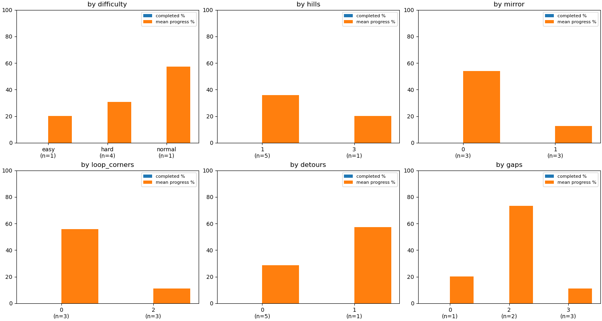

# 랜덤 맵 주행 요약

- 실행: 2026-11-24 17:55:10 · 소요 2.8분
- **시드 1457145442** · 세트 general200, official_like50, hills60, stress50 · 뽑기 balanced · 맵 6개
- 재현: `python3 experiments/eval/random_drive.py 6 --seed 1457145442 --suites general200,official_like50,hills60,stress50 --mode balanced` (같은 follower, LF_PARAMS)
- follower `experiments/user_base/run_guarded.py` · LF_PARAMS `/ws/src/line_follower/config/rule.yaml`
- bench: backend run_eval, --off 0.12, --limit 300 s, --stall 20 s, --jobs 2, 도메인 70–89, 파티션 `lf_g_drive_*`

## 결과

- **완주 0/6** (0%)
- 평균 진행률 33.4%
- 평균 랩타임(완주한 맵) -

## 맵별 결과

| # | 세트 | 맵 | 난이도 | 언덕 | 반전 | 코너 원 | 교차로 | 막대 | 끊김 | 물방울 | 상자 | 길이 m | 완주 | 진행률 | 랩 s | 결과 |
|---|---|---|---|---|---|---|---|---|---|---|---|---|---|---|---|---|
| 1 | general200 | normal_1055 | normal | 1 | 0 | 0 | 1 | 2 | 2 | 0 | 0 | 17.746 | X | 57.3% | - | off line >0.12m at 10.20m |
| 2 | official_like50 | hard_5036_m | hard | 1 | 1 | 2 | 0 | 2 | 3 | 0 | 0 | 17.352 | X | 13.0% | - | off line >0.12m at 2.08m |
| 3 | stress50 | hard_7018 | hard | 1 | 0 | 2 | 0 | 4 | 3 | 1 | 0 | 18.392 | X | 15.3% | - | off line >0.12m at 2.72m |
| 4 | stress50 | hard_7037_m | hard | 1 | 1 | 2 | 0 | 3 | 3 | 2 | 0 | 19.322 | X | 5.0% | - | off line >0.12m at 1.01m |
| 5 | general200 | hard_1059 | hard | 1 | 0 | 0 | 0 | 1 | 2 | 0 | 0 | 15.894 | X | 89.4% | - | stalled at 14.21m |
| 6 | hills60 | easy_9024_m | easy | 3 | 1 | 0 | 0 | 0 | 0 | 0 | 0 | 15.646 | X | 20.3% | - | off line >0.12m at 3.20m |

## 실패 원인

- **선 이탈** 5건: normal_1055 (10.20 m, 57%), hard_5036_m (2.08 m, 13%), hard_7018 (2.72 m, 15%), hard_7037_m (1.01 m, 5%), easy_9024_m (3.20 m, 20%)
- **정지(진행 없음)** 1건: hard_1059 (14.21 m, 89%)
  - 노드가 종점 T를 봤다고 판단하고 스스로 멈춤(follower 로그 'reached finish'): hard_1059 (주행 14.29 m, 실제 끝까지 1.69 m 남음). finish_min_dist 이후 보이는 T자·막대·곁가지를 종점으로 본 조기 종점 판정이다.

## 세트별·요소별 완주율

### 세트

| 세트 | 맵 | 완주 | 완주율 | 평균 진행률 | 평균 랩 |
|---|---|---|---|---|---|
| hills60 | 1 | 0 | 0% | 20.3% | - |
| stress50 | 2 | 0 | 0% | 10.2% | - |
| general200 | 2 | 0 | 0% | 73.3% | - |
| official_like50 | 1 | 0 | 0% | 13.0% | - |

### 난이도

| 난이도 | 맵 | 완주 | 완주율 | 평균 진행률 | 평균 랩 |
|---|---|---|---|---|---|
| easy | 1 | 0 | 0% | 20.3% | - |
| hard | 4 | 0 | 0% | 30.7% | - |
| normal | 1 | 0 | 0% | 57.3% | - |

### 언덕 수

| 언덕 수 | 맵 | 완주 | 완주율 | 평균 진행률 | 평균 랩 |
|---|---|---|---|---|---|
| 1 | 5 | 0 | 0% | 36.0% | - |
| 3 | 1 | 0 | 0% | 20.3% | - |

### 좌우 반전

| 좌우 반전 | 맵 | 완주 | 완주율 | 평균 진행률 | 평균 랩 |
|---|---|---|---|---|---|
| 0 | 3 | 0 | 0% | 54.0% | - |
| 1 | 3 | 0 | 0% | 12.8% | - |

### 코너 원

| 코너 원 | 맵 | 완주 | 완주율 | 평균 진행률 | 평균 랩 |
|---|---|---|---|---|---|
| 0 | 3 | 0 | 0% | 55.7% | - |
| 2 | 3 | 0 | 0% | 11.1% | - |

### 연결 교차로

| 연결 교차로 | 맵 | 완주 | 완주율 | 평균 진행률 | 평균 랩 |
|---|---|---|---|---|---|
| 0 | 5 | 0 | 0% | 28.6% | - |
| 1 | 1 | 0 | 0% | 57.3% | - |

### 교차 막대+곁가지

| 교차 막대+곁가지 | 맵 | 완주 | 완주율 | 평균 진행률 | 평균 랩 |
|---|---|---|---|---|---|
| 0 | 1 | 0 | 0% | 20.3% | - |
| 1 | 1 | 0 | 0% | 89.4% | - |
| 2 | 2 | 0 | 0% | 35.1% | - |
| 3 | 1 | 0 | 0% | 5.0% | - |
| 4 | 1 | 0 | 0% | 15.3% | - |

### 끊긴 길

| 끊긴 길 | 맵 | 완주 | 완주율 | 평균 진행률 | 평균 랩 |
|---|---|---|---|---|---|
| 0 | 1 | 0 | 0% | 20.3% | - |
| 2 | 2 | 0 | 0% | 73.3% | - |
| 3 | 3 | 0 | 0% | 11.1% | - |

### 물방울 원

| 물방울 원 | 맵 | 완주 | 완주율 | 평균 진행률 | 평균 랩 |
|---|---|---|---|---|---|
| 0 | 4 | 0 | 0% | 45.0% | - |
| 1 | 1 | 0 | 0% | 15.3% | - |
| 2 | 1 | 0 | 0% | 5.0% | - |

### 상자

| 상자 | 맵 | 완주 | 완주율 | 평균 진행률 | 평균 랩 |
|---|---|---|---|---|---|
| 0 | 6 | 0 | 0% | 33.4% | - |

## 부록: worlds/summarize_suite.py 출력

```
runs 6  (infrastructure errors 0 excluded)
ALL                      0/6     0.0%  mean  33.4%  lap      -    hits 0
  difficulty=easy        0/1     0.0%  mean  20.3%  lap      -    hits 0
  difficulty=hard        0/4     0.0%  mean  30.7%  lap      -    hits 0
  difficulty=normal      0/1     0.0%  mean  57.3%  lap      -    hits 0
  hills=1                0/5     0.0%  mean  36.0%  lap      -    hits 0
  hills=3                0/1     0.0%  mean  20.3%  lap      -    hits 0
  mirror=0               0/3     0.0%  mean  54.0%  lap      -    hits 0
  mirror=1               0/3     0.0%  mean  12.8%  lap      -    hits 0
  loop_corners=0         0/3     0.0%  mean  55.7%  lap      -    hits 0
  loop_corners=2         0/3     0.0%  mean  11.1%  lap      -    hits 0
  detours=0              0/5     0.0%  mean  28.6%  lap      -    hits 0
  detours=1              0/1     0.0%  mean  57.3%  lap      -    hits 0
  bars=0                 0/1     0.0%  mean  20.3%  lap      -    hits 0
  bars=1                 0/1     0.0%  mean  89.4%  lap      -    hits 0
  bars=2                 0/2     0.0%  mean  35.1%  lap      -    hits 0
  bars=3                 0/1     0.0%  mean   5.0%  lap      -    hits 0
  bars=4                 0/1     0.0%  mean  15.3%  lap      -    hits 0
  gaps=0                 0/1     0.0%  mean  20.3%  lap      -    hits 0
  gaps=2                 0/2     0.0%  mean  73.3%  lap      -    hits 0
  gaps=3                 0/3     0.0%  mean  11.1%  lap      -    hits 0
  small_loops=0          0/4     0.0%  mean  45.0%  lap      -    hits 0
  small_loops=1          0/1     0.0%  mean  15.3%  lap      -    hits 0
  small_loops=2          0/1     0.0%  mean   5.0%  lap      -    hits 0
  obstacles=0            0/6     0.0%  mean  33.4%  lap      -    hits 0
worst maps:
  hard_7037_m.sdf                          5.0%  off line >0.12m at 1.01m
  hard_5036_m.sdf                          13.0%  off line >0.12m at 2.08m
  hard_7018.sdf                            15.3%  off line >0.12m at 2.72m
  easy_9024_m.sdf                          20.3%  off line >0.12m at 3.20m
  normal_1055.sdf                          57.3%  off line >0.12m at 10.20m
  hard_1059.sdf                            89.4%  stalled at 14.21m
wrote /ws/experiments/results/safety/guarded/random6_seed1457145442/by_feature.png
```



