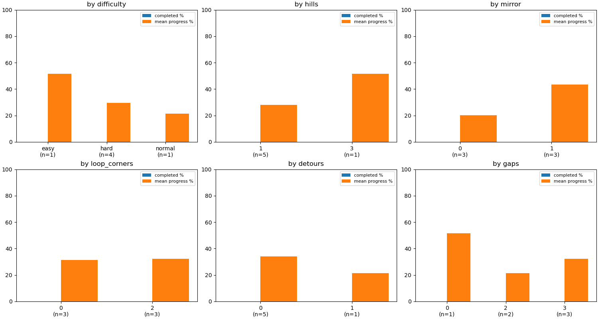

# 랜덤 맵 주행 요약

- 실행: 2026-11-24 21:58:29 · 소요 2.1분
- **시드 1457145442** · 세트 general200, official_like50, hills60, stress50 · 뽑기 balanced · 맵 6개
- 재현: `python3 experiments/eval/random_drive.py 6 --seed 1457145442 --suites general200,official_like50,hills60,stress50 --mode balanced` (같은 follower, LF_PARAMS)
- follower `experiments/user_base/run_user.py` · LF_PARAMS `/ws/src/line_follower/config/playbook_rule.yaml`
- bench: backend run_eval, --off 0.12, --limit 300 s, --stall 20 s, --jobs 3, 도메인 50–69, 파티션 `lf_l_rand_playbook_*`

## 결과

- **완주 0/6** (0%)
- 평균 진행률 31.9%
- 평균 랩타임(완주한 맵) -

## 맵별 결과

| # | 세트 | 맵 | 난이도 | 언덕 | 반전 | 코너 원 | 교차로 | 막대 | 끊김 | 물방울 | 상자 | 길이 m | 완주 | 진행률 | 랩 s | 결과 |
|---|---|---|---|---|---|---|---|---|---|---|---|---|---|---|---|---|
| 1 | general200 | normal_1055 | normal | 1 | 0 | 0 | 1 | 2 | 2 | 0 | 0 | 17.746 | X | 21.5% | - | off line >0.12m at 3.81m |
| 2 | official_like50 | hard_5036_m | hard | 1 | 1 | 2 | 0 | 2 | 3 | 0 | 0 | 17.352 | X | 73.6% | - | off line >0.12m at 12.77m |
| 3 | stress50 | hard_7018 | hard | 1 | 0 | 2 | 0 | 4 | 3 | 1 | 0 | 18.392 | X | 18.4% | - | off line >0.12m at 3.40m |
| 4 | stress50 | hard_7037_m | hard | 1 | 1 | 2 | 0 | 3 | 3 | 2 | 0 | 19.322 | X | 5.2% | - | off line >0.12m at 1.06m |
| 5 | general200 | hard_1059 | hard | 1 | 0 | 0 | 0 | 1 | 2 | 0 | 0 | 15.894 | X | 21.1% | - | off line >0.12m at 3.38m |
| 6 | hills60 | easy_9024_m | easy | 3 | 1 | 0 | 0 | 0 | 0 | 0 | 0 | 15.646 | X | 51.5% | - | off line >0.12m at 8.16m |

## 실패 원인

- **선 이탈** 6건: normal_1055 (3.81 m, 22%), hard_5036_m (12.77 m, 74%), hard_7018 (3.40 m, 18%), hard_7037_m (1.06 m, 5%), hard_1059 (3.38 m, 21%), easy_9024_m (8.16 m, 52%)

## 세트별·요소별 완주율

### 세트

| 세트 | 맵 | 완주 | 완주율 | 평균 진행률 | 평균 랩 |
|---|---|---|---|---|---|
| hills60 | 1 | 0 | 0% | 51.5% | - |
| stress50 | 2 | 0 | 0% | 11.8% | - |
| general200 | 2 | 0 | 0% | 21.3% | - |
| official_like50 | 1 | 0 | 0% | 73.6% | - |

### 난이도

| 난이도 | 맵 | 완주 | 완주율 | 평균 진행률 | 평균 랩 |
|---|---|---|---|---|---|
| easy | 1 | 0 | 0% | 51.5% | - |
| hard | 4 | 0 | 0% | 29.6% | - |
| normal | 1 | 0 | 0% | 21.5% | - |

### 언덕 수

| 언덕 수 | 맵 | 완주 | 완주율 | 평균 진행률 | 평균 랩 |
|---|---|---|---|---|---|
| 1 | 5 | 0 | 0% | 28.0% | - |
| 3 | 1 | 0 | 0% | 51.5% | - |

### 좌우 반전

| 좌우 반전 | 맵 | 완주 | 완주율 | 평균 진행률 | 평균 랩 |
|---|---|---|---|---|---|
| 0 | 3 | 0 | 0% | 20.3% | - |
| 1 | 3 | 0 | 0% | 43.4% | - |

### 코너 원

| 코너 원 | 맵 | 완주 | 완주율 | 평균 진행률 | 평균 랩 |
|---|---|---|---|---|---|
| 0 | 3 | 0 | 0% | 31.4% | - |
| 2 | 3 | 0 | 0% | 32.4% | - |

### 연결 교차로

| 연결 교차로 | 맵 | 완주 | 완주율 | 평균 진행률 | 평균 랩 |
|---|---|---|---|---|---|
| 0 | 5 | 0 | 0% | 34.0% | - |
| 1 | 1 | 0 | 0% | 21.5% | - |

### 교차 막대+곁가지

| 교차 막대+곁가지 | 맵 | 완주 | 완주율 | 평균 진행률 | 평균 랩 |
|---|---|---|---|---|---|
| 0 | 1 | 0 | 0% | 51.5% | - |
| 1 | 1 | 0 | 0% | 21.1% | - |
| 2 | 2 | 0 | 0% | 47.5% | - |
| 3 | 1 | 0 | 0% | 5.2% | - |
| 4 | 1 | 0 | 0% | 18.4% | - |

### 끊긴 길

| 끊긴 길 | 맵 | 완주 | 완주율 | 평균 진행률 | 평균 랩 |
|---|---|---|---|---|---|
| 0 | 1 | 0 | 0% | 51.5% | - |
| 2 | 2 | 0 | 0% | 21.3% | - |
| 3 | 3 | 0 | 0% | 32.4% | - |

### 물방울 원

| 물방울 원 | 맵 | 완주 | 완주율 | 평균 진행률 | 평균 랩 |
|---|---|---|---|---|---|
| 0 | 4 | 0 | 0% | 41.9% | - |
| 1 | 1 | 0 | 0% | 18.4% | - |
| 2 | 1 | 0 | 0% | 5.2% | - |

### 상자

| 상자 | 맵 | 완주 | 완주율 | 평균 진행률 | 평균 랩 |
|---|---|---|---|---|---|
| 0 | 6 | 0 | 0% | 31.9% | - |

## 부록: worlds/summarize_suite.py 출력

```
runs 6  (infrastructure errors 0 excluded)
ALL                      0/6     0.0%  mean  31.9%  lap      -    hits 0
  difficulty=easy        0/1     0.0%  mean  51.5%  lap      -    hits 0
  difficulty=hard        0/4     0.0%  mean  29.6%  lap      -    hits 0
  difficulty=normal      0/1     0.0%  mean  21.5%  lap      -    hits 0
  hills=1                0/5     0.0%  mean  28.0%  lap      -    hits 0
  hills=3                0/1     0.0%  mean  51.5%  lap      -    hits 0
  mirror=0               0/3     0.0%  mean  20.3%  lap      -    hits 0
  mirror=1               0/3     0.0%  mean  43.4%  lap      -    hits 0
  loop_corners=0         0/3     0.0%  mean  31.4%  lap      -    hits 0
  loop_corners=2         0/3     0.0%  mean  32.4%  lap      -    hits 0
  detours=0              0/5     0.0%  mean  34.0%  lap      -    hits 0
  detours=1              0/1     0.0%  mean  21.5%  lap      -    hits 0
  bars=0                 0/1     0.0%  mean  51.5%  lap      -    hits 0
  bars=1                 0/1     0.0%  mean  21.1%  lap      -    hits 0
  bars=2                 0/2     0.0%  mean  47.5%  lap      -    hits 0
  bars=3                 0/1     0.0%  mean   5.2%  lap      -    hits 0
  bars=4                 0/1     0.0%  mean  18.4%  lap      -    hits 0
  gaps=0                 0/1     0.0%  mean  51.5%  lap      -    hits 0
  gaps=2                 0/2     0.0%  mean  21.3%  lap      -    hits 0
  gaps=3                 0/3     0.0%  mean  32.4%  lap      -    hits 0
  small_loops=0          0/4     0.0%  mean  41.9%  lap      -    hits 0
  small_loops=1          0/1     0.0%  mean  18.4%  lap      -    hits 0
  small_loops=2          0/1     0.0%  mean   5.2%  lap      -    hits 0
  obstacles=0            0/6     0.0%  mean  31.9%  lap      -    hits 0
worst maps:
  hard_7037_m.sdf                          5.2%  off line >0.12m at 1.06m
  hard_7018.sdf                            18.4%  off line >0.12m at 3.40m
  hard_1059.sdf                            21.1%  off line >0.12m at 3.38m
  normal_1055.sdf                          21.5%  off line >0.12m at 3.81m
  easy_9024_m.sdf                          51.5%  off line >0.12m at 8.16m
  hard_5036_m.sdf                          73.6%  off line >0.12m at 12.77m
wrote /ws/experiments/results/situation/playbook/random/by_feature.png
```



