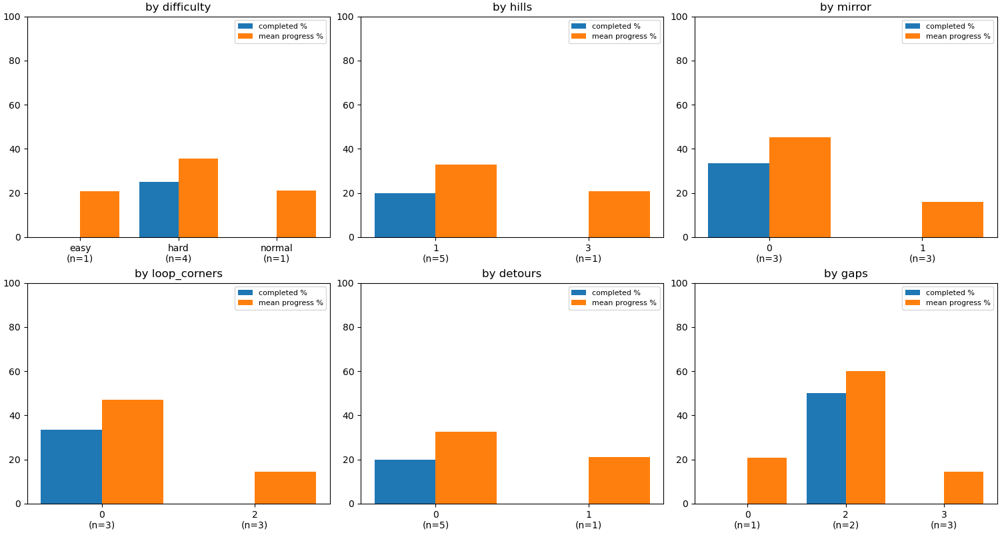

# 랜덤 맵 주행 요약

- 실행: 2026-11-24 18:05:13 · 소요 1.9분
- **시드 1457145442** · 세트 general200, official_like50, hills60, stress50 · 뽑기 balanced · 맵 6개
- 재현: `python3 experiments/eval/random_drive.py 6 --seed 1457145442 --suites general200,official_like50,hills60,stress50 --mode balanced` (같은 follower, LF_PARAMS)
- follower `experiments/user_base/run_user.py` · LF_PARAMS `/ws/src/line_follower/config/playbook_rule.yaml`
- bench: backend run_eval, --off 0.12, --limit 300 s, --stall 20 s, --jobs 3, 도메인 50–69, 파티션 `lf_l_rand_playbook_v0_*`

## 결과

- **완주 1/6** (17%)
- 평균 진행률 30.7%
- 평균 랩타임(완주한 맵) 70.0 s

## 맵별 결과

| # | 세트 | 맵 | 난이도 | 언덕 | 반전 | 코너 원 | 교차로 | 막대 | 끊김 | 물방울 | 상자 | 길이 m | 완주 | 진행률 | 랩 s | 결과 |
|---|---|---|---|---|---|---|---|---|---|---|---|---|---|---|---|---|
| 1 | general200 | normal_1055 | normal | 1 | 0 | 0 | 1 | 2 | 2 | 0 | 0 | 17.746 | X | 21.0% | - | off line >0.12m at 3.76m |
| 2 | official_like50 | hard_5036_m | hard | 1 | 1 | 2 | 0 | 2 | 3 | 0 | 0 | 17.352 | X | 13.1% | - | off line >0.12m at 2.36m |
| 3 | stress50 | hard_7018 | hard | 1 | 0 | 2 | 0 | 4 | 3 | 1 | 0 | 18.392 | X | 15.8% | - | off line >0.12m at 2.92m |
| 4 | stress50 | hard_7037_m | hard | 1 | 1 | 2 | 0 | 3 | 3 | 2 | 0 | 19.322 | X | 14.5% | - | off line >0.12m at 2.84m |
| 5 | general200 | hard_1059 | hard | 1 | 0 | 0 | 0 | 1 | 2 | 0 | 0 | 15.894 | O | 99.3% | 70.0 | finished |
| 6 | hills60 | easy_9024_m | easy | 3 | 1 | 0 | 0 | 0 | 0 | 0 | 0 | 15.646 | X | 20.7% | - | off line >0.12m at 3.26m |

## 실패 원인

- **선 이탈** 5건: normal_1055 (3.76 m, 21%), hard_5036_m (2.36 m, 13%), hard_7018 (2.92 m, 16%), hard_7037_m (2.84 m, 14%), easy_9024_m (3.26 m, 21%)

## 세트별·요소별 완주율

### 세트

| 세트 | 맵 | 완주 | 완주율 | 평균 진행률 | 평균 랩 |
|---|---|---|---|---|---|
| hills60 | 1 | 0 | 0% | 20.7% | - |
| stress50 | 2 | 0 | 0% | 15.2% | - |
| general200 | 2 | 1 | 50% | 60.1% | 70.0 s |
| official_like50 | 1 | 0 | 0% | 13.1% | - |

### 난이도

| 난이도 | 맵 | 완주 | 완주율 | 평균 진행률 | 평균 랩 |
|---|---|---|---|---|---|
| easy | 1 | 0 | 0% | 20.7% | - |
| hard | 4 | 1 | 25% | 35.7% | 70.0 s |
| normal | 1 | 0 | 0% | 21.0% | - |

### 언덕 수

| 언덕 수 | 맵 | 완주 | 완주율 | 평균 진행률 | 평균 랩 |
|---|---|---|---|---|---|
| 1 | 5 | 1 | 20% | 32.7% | 70.0 s |
| 3 | 1 | 0 | 0% | 20.7% | - |

### 좌우 반전

| 좌우 반전 | 맵 | 완주 | 완주율 | 평균 진행률 | 평균 랩 |
|---|---|---|---|---|---|
| 0 | 3 | 1 | 33% | 45.4% | 70.0 s |
| 1 | 3 | 0 | 0% | 16.1% | - |

### 코너 원

| 코너 원 | 맵 | 완주 | 완주율 | 평균 진행률 | 평균 랩 |
|---|---|---|---|---|---|
| 0 | 3 | 1 | 33% | 47.0% | 70.0 s |
| 2 | 3 | 0 | 0% | 14.5% | - |

### 연결 교차로

| 연결 교차로 | 맵 | 완주 | 완주율 | 평균 진행률 | 평균 랩 |
|---|---|---|---|---|---|
| 0 | 5 | 1 | 20% | 32.7% | 70.0 s |
| 1 | 1 | 0 | 0% | 21.0% | - |

### 교차 막대+곁가지

| 교차 막대+곁가지 | 맵 | 완주 | 완주율 | 평균 진행률 | 평균 랩 |
|---|---|---|---|---|---|
| 0 | 1 | 0 | 0% | 20.7% | - |
| 1 | 1 | 1 | 100% | 99.3% | 70.0 s |
| 2 | 2 | 0 | 0% | 17.1% | - |
| 3 | 1 | 0 | 0% | 14.5% | - |
| 4 | 1 | 0 | 0% | 15.8% | - |

### 끊긴 길

| 끊긴 길 | 맵 | 완주 | 완주율 | 평균 진행률 | 평균 랩 |
|---|---|---|---|---|---|
| 0 | 1 | 0 | 0% | 20.7% | - |
| 2 | 2 | 1 | 50% | 60.1% | 70.0 s |
| 3 | 3 | 0 | 0% | 14.5% | - |

### 물방울 원

| 물방울 원 | 맵 | 완주 | 완주율 | 평균 진행률 | 평균 랩 |
|---|---|---|---|---|---|
| 0 | 4 | 1 | 25% | 38.5% | 70.0 s |
| 1 | 1 | 0 | 0% | 15.8% | - |
| 2 | 1 | 0 | 0% | 14.5% | - |

### 상자

| 상자 | 맵 | 완주 | 완주율 | 평균 진행률 | 평균 랩 |
|---|---|---|---|---|---|
| 0 | 6 | 1 | 17% | 30.7% | 70.0 s |

## 부록: worlds/summarize_suite.py 출력

```
runs 6  (infrastructure errors 0 excluded)
ALL                      1/6    16.7%  mean  30.7%  lap   70.0 s  hits 0
  difficulty=easy        0/1     0.0%  mean  20.7%  lap      -    hits 0
  difficulty=hard        1/4    25.0%  mean  35.7%  lap   70.0 s  hits 0
  difficulty=normal      0/1     0.0%  mean  21.0%  lap      -    hits 0
  hills=1                1/5    20.0%  mean  32.7%  lap   70.0 s  hits 0
  hills=3                0/1     0.0%  mean  20.7%  lap      -    hits 0
  mirror=0               1/3    33.3%  mean  45.4%  lap   70.0 s  hits 0
  mirror=1               0/3     0.0%  mean  16.1%  lap      -    hits 0
  loop_corners=0         1/3    33.3%  mean  47.0%  lap   70.0 s  hits 0
  loop_corners=2         0/3     0.0%  mean  14.5%  lap      -    hits 0
  detours=0              1/5    20.0%  mean  32.7%  lap   70.0 s  hits 0
  detours=1              0/1     0.0%  mean  21.0%  lap      -    hits 0
  bars=0                 0/1     0.0%  mean  20.7%  lap      -    hits 0
  bars=1                 1/1   100.0%  mean  99.3%  lap   70.0 s  hits 0
  bars=2                 0/2     0.0%  mean  17.1%  lap      -    hits 0
  bars=3                 0/1     0.0%  mean  14.5%  lap      -    hits 0
  bars=4                 0/1     0.0%  mean  15.8%  lap      -    hits 0
  gaps=0                 0/1     0.0%  mean  20.7%  lap      -    hits 0
  gaps=2                 1/2    50.0%  mean  60.1%  lap   70.0 s  hits 0
  gaps=3                 0/3     0.0%  mean  14.5%  lap      -    hits 0
  small_loops=0          1/4    25.0%  mean  38.5%  lap   70.0 s  hits 0
  small_loops=1          0/1     0.0%  mean  15.8%  lap      -    hits 0
  small_loops=2          0/1     0.0%  mean  14.5%  lap      -    hits 0
  obstacles=0            1/6    16.7%  mean  30.7%  lap   70.0 s  hits 0
worst maps:
  hard_5036_m.sdf                          13.1%  off line >0.12m at 2.36m
  hard_7037_m.sdf                          14.5%  off line >0.12m at 2.84m
  hard_7018.sdf                            15.8%  off line >0.12m at 2.92m
  easy_9024_m.sdf                          20.7%  off line >0.12m at 3.26m
  normal_1055.sdf                          21.0%  off line >0.12m at 3.76m
  hard_1059.sdf                            99.3%  finished
wrote /ws/experiments/results/situation/playbook_v0/random/by_feature.png
```



